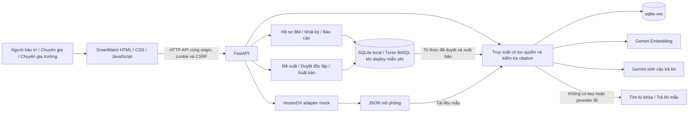
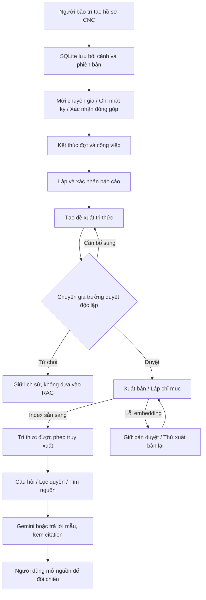

# DENSO SmartMaint — demo bảo trì và RAG

DENSO SmartMaint là bản demo quản lý hồ sơ bảo trì CNC, phối hợp chuyên gia và tra cứu tri thức có dẫn nguồn. Backend dùng FastAPI, database nghiệp vụ dùng SQLite, tìm kiếm vector dùng sqlite-vec và Gemini Embedding; Gemini sinh câu trả lời từ nguồn đã truy xuất. Demo cũng chạy được ở chế độ từ khóa và trả lời mẫu khi chưa có API key.

HozenDX hiện dùng mock, dữ liệu mẫu là mô phỏng. Xem [tình trạng bàn giao và giới hạn](docs/guides/DEMO-HANDOVER.md).

[Mã nguồn GitHub](https://github.com/nguyenhoangduong17122005-glitch/DENSO_Knowledge_Graph) · [Chạy nhanh bằng Docker](#chạy-nhanh-bằng-docker) · [Hướng dẫn Live Demo](docs/guides/LIVE-DEMO-DEPLOYMENT.md)

[Kết quả kiểm tra Docker trên GitHub Actions](https://github.com/nguyenhoangduong17122005-glitch/DENSO_Knowledge_Graph/actions/workflows/docker-smoke.yml) — mở workflow để xem kết quả của commit mới nhất; có file workflow không đồng nghĩa lần chạy đã đạt.

**Live Demo:** chưa xuất bản. Link truy cập sẽ được gắn tại đây sau khi hosting triển khai thành công và luồng lưu dữ liệu/RAG được kiểm tra trên URL thật. `127.0.0.1` bên dưới chỉ là địa chỉ chạy local.

## Live Demo với hosting miễn phí

`render.yaml` dùng **Render Free + Turso Free (engine libSQL)**, không có disk trả phí. Hồ sơ, nhật ký, báo cáo và tri thức lưu ở Turso; chỉ mục vector trên Render là cache có thể tạo lại. Chạy local/Docker mặc định vẫn dùng SQLite. Cần tạo database Turso và đặt URL/token riêng trong Render trước khi deploy; chưa có URL Live Demo được xác minh.

Đọc [hướng dẫn triển khai miễn phí](docs/guides/LIVE-DEMO-DEPLOYMENT.md) để tạo database, kết nối repo và kiểm tra hồ sơ còn sau restart. Mặc định cloud dùng từ khóa/trả lời mẫu; Gemini cần cấu hình key/hạn mức riêng. Render Free có thể ngủ khi không hoạt động. [Render Free](https://render.com/docs/free), [Turso Free](https://turso.tech/pricing).

## Kiến trúc hệ thống



Frontend và backend được phục vụ cùng origin khi chạy local, Docker hoặc toàn bộ ứng dụng trên Render. Chạy local dùng SQLite; hosting miễn phí lưu nghiệp vụ ở Turso, chỉ mục vector là cache trên Render. API key chỉ ở backend. Phân quyền được kiểm tra khi đọc/ghi và khi truy xuất nguồn.

## Luồng dữ liệu



Hồ sơ vừa tạo và bản nháp đề xuất không tự trở thành nguồn RAG. Chỉ tri thức đã xuất bản thành công mới đi vào luồng truy xuất, cùng bộ tài liệu mẫu đã chuẩn bị.

## Ảnh chụp kết quả

Ảnh được chụp từ ứng dụng chạy thật bằng Edge, sử dụng database kiểm thử riêng và dữ liệu mô phỏng. Ảnh trả lời dùng chế độ từ khóa/mẫu; không phải bằng chứng của một lần gọi Gemini thật.

**Chọn vai trò demo**


**Hồ sơ CNC và bối cảnh công việc**


**Kết quả tra cứu/trả lời có nguồn đối chiếu**


**Tri thức đã duyệt và xuất bản**


Có thể tạo lại ảnh bằng lệnh kiểm thử: `.\.venv\Scripts\python.exe -m backend.browser_smoke --original-ui --docs-screenshots` (cần Edge và thư viện kiểm thử).

## Chạy nhanh bằng Docker

Cần Docker Engine/Docker Desktop và Docker Compose. Chạy từ thư mục dự án:

Docker đã được build và chạy thành công trên [GitHub Actions](https://github.com/nguyenhoangduong17122005-glitch/DENSO_Knowledge_Graph/actions/runs/38124622577): chọn vai trò, trả lời có nguồn, tạo hồ sơ và giữ hồ sơ sau restart container. Adapter lưu trữ miễn phí đã [đạt kiểm tra với server libSQL thật trong CI](https://github.com/nguyenhoangduong17122005-glitch/DENSO_Knowledge_Graph/actions/runs/38131288432), gồm lưu hồ sơ sau tạo lại ứng dụng và luồng báo cáo → duyệt → xuất bản → trả lời có citation. Chưa xác minh database Turso Cloud/URL Render trong tài khoản của bạn.

```bash
git clone https://github.com/nguyenhoangduong17122005-glitch/DENSO_Knowledge_Graph.git
cd DENSO_Knowledge_Graph
docker compose up --build -d
```

Mở **http://127.0.0.1:8001/** → chọn **Người bảo trì — Nguyễn Minh** → **Vào bản demo**. Lần chạy đầu tự tạo 5 hồ sơ mẫu. Không cần Python trên máy chủ Docker hoặc API key để thử luồng nghiệp vụ và tra cứu theo mẫu.

```bash
# Xem trạng thái và log
docker compose ps
docker compose logs -f smartmaint

# Dừng ứng dụng; giữ database trong named volume
docker compose down

# Chạy lại
docker compose up -d
```

Database trong container nằm tại `/data/smartmaint.sqlite3`, chỉ mục tại `/data/rag-vectors.sqlite3`, được giữ bằng volume `smartmaint-data`. Đây là database riêng với `.runtime/smartmaint.sqlite3` khi chạy trực tiếp bằng Python. Chạy lại container không ghi đè hồ sơ đã có. Không xóa volume nếu cần giữ dữ liệu.

Compose đọc các biến trong `.env` nếu file đã có. Không có `.env`, mặc định dùng `keyword`/`template`. Muốn Gemini thật, điền `GEMINI_API_KEY`, đặt `SMARTMAINT_RETRIEVAL_MODE=vector`, `SMARTMAINT_ANSWER_MODE=gemini`, rồi chạy lại `docker compose up -d`. Đọc [hướng dẫn Gemini](docs/guides/DENSO-RAG-VECTOR-GEMINI.md) trước khi dùng hạn mức API. `.dockerignore` loại key, database cá nhân và cache khỏi image.

## Chạy chương trình

### Lần đầu trên máy mới

1. Cài Python có `pip` và Python Launcher (`py` trên Windows). Dự án đã được kiểm thử với Python 3.14.
2. Tải repo bằng **Code → Download ZIP**, giải nén, hoặc clone bằng Git.
3. Trên Windows, chạy **Cai-dat-demo.cmd** một lần. File này tạo `.venv`, cài thư viện, tạo `.env` ở chế độ offline nếu chưa có và khởi tạo tài khoản/hồ sơ mẫu. Cần Internet để tải thư viện. Chạy lại không ghi đè cấu hình, mật khẩu hoặc hồ sơ đã có.
4. Chạy **Chay-demo.cmd**, giữ cửa sổ máy chủ mở. Chọn vai trò để dùng thử, không cần mật khẩu.

Máy mới được tạo 5 hồ sơ mẫu và các tài khoản demo. `.env`, `.venv` và `.runtime` được tạo trên máy người dùng, không có trong repo. Chạy các lệnh Terminal bên dưới từ thư mục chứa `README.md`, `backend/` và `frontend/`.

Demo mới cài dùng tìm kiếm từ khóa và câu trả lời mẫu, chưa gọi Gemini. Muốn dùng embedding/vector và Gemini thật, sửa hai dòng trong `.env` thành `SMARTMAINT_RETRIEVAL_MODE=vector`, `SMARTMAINT_ANSWER_MODE=gemini`, điền API key riêng, rồi khởi động lại. Xem [hướng dẫn Gemini](docs/guides/DENSO-RAG-VECTOR-GEMINI.md).

Nếu dùng Terminal trên Windows thay vì file cài đặt:

```powershell
py -m venv .venv
.\.venv\Scripts\python.exe -m pip install -r backend/requirements.txt
.\.venv\Scripts\python.exe -m backend.setup_demo
.\.venv\Scripts\python.exe -m backend.launch_demo
```

Các file `.cmd` tự dùng Python trong `.venv` nếu có. Nếu cài thư viện kiểm thử, dùng cùng Python đó: `.\.venv\Scripts\python.exe -m pip install -r backend/requirements-dev.txt`.

### Các lần sau

Nhấp đúp **Chay-demo.cmd**, giữ cửa sổ máy chủ mở, rồi dùng **http://127.0.0.1:8001/**. Hoặc chạy trong thư mục dự án:

```powershell
.\.venv\Scripts\python.exe -m backend.launch_demo
```

Mở **http://127.0.0.1:8001/** nếu trình duyệt chưa tự mở. Dừng máy chủ bằng **Ctrl+C** trong cửa sổ đang chạy. Sau khi sửa `.env`, dừng máy chủ cũ rồi chạy lại; nhấn **Ctrl+F5** nếu trình duyệt vẫn hiện giao diện cũ.

## Sử dụng và kiểm tra lưu dữ liệu

Giao diện SmartMaint được giữ lại. Chọn **Người bảo trì — Nguyễn Minh**, vào **Hồ sơ công việc**, bấm **Mở công việc BM** để tạo hồ sơ CNC-04 trong SQLite. Danh sách hồ sơ đọc trực tiếp từ máy chủ; nút **Mở hồ sơ** mở phần bối cảnh, nhật ký và RAG dùng API trong giao diện SmartMaint. Mục **Hồ sơ CNC & tra cứu** vẫn truy cập cùng database.

Hồ sơ CNC BM cũ trong trình duyệt xuất hiện với nút **Chuyển hồ sơ vào database**. Xác nhận để giữ mã hồ sơ, bối cảnh, đợt xử lý và ghi nhận; bản gốc không bị xóa. Các xác nhận/báo cáo/trạng thái phục hồi cũ được lưu trong `legacy_case_snapshots.payload_json` để đối chiếu, không tự trở thành xác nhận trên máy chủ. Hồ sơ trùng mã bị từ chối ghi đè. Dữ liệu trình duyệt phụ thuộc trình duyệt và địa chỉ đã dùng; hồ sơ tạo tại cổng 5500 không tự xuất hiện tại cổng 8001.

Để kiểm tra lưu dữ liệu: tạo tên riêng, ví dụ `DEMO-KT02: Kiểm tra SQLite`, ghi hiện tượng và lý do mở công việc độc lập, xác nhận máy, bấm tạo. Quay lại **Hồ sơ công việc**, tải lại trang; hồ sơ vẫn xuất hiện. Có thể mở `.runtime/smartmaint.sqlite3` bằng SQLite Viewer và xem bảng `cases`, `case_context_versions`, `case_rounds`, `case_event_versions`.

**Đồng bộ màn hình:** Tổng quan, Hồ sơ công việc, Hồ sơ tham gia và Hỗ trợ & xác nhận đọc cùng SQLite theo quyền tài khoản. Số liệu tổng quan được tải lại khi mở trang hoặc quay lại tab. Dữ liệu HozenDX đọc adapter mock trên máy chủ và hiển thị các hồ sơ SmartMaint cùng máy trong phạm vi truy cập. Đường dẫn hồ sơ gốc cũng mở bản database; bản cũ trên trình duyệt được giữ riêng ở chế độ chỉ xem và có thể nhập hồ sơ CNC BM vào database.

**Luồng BM đã lưu database:** người bảo trì gửi yêu cầu hỗ trợ; chuyên gia nhận hoặc từ chối ở Tổng quan / Hỗ trợ & xác nhận. Sau khi nhận, chuyên gia được thêm vào phạm vi hồ sơ để ghi nhật ký và xác nhận phần mình thực hiện. Người bảo trì kết thúc đợt, ghi kết quả kiểm chứng để kết thúc công việc, lập báo cáo có phiên bản và xác nhận báo cáo cuối cùng. Lời mời đang chờ có thể hủy; không kết thúc công việc khi còn đợt đang làm hoặc lời mời đang chờ.

**Tri thức và RAG:** báo cáo đã xác nhận có thể tạo đề xuất, lưu các phiên bản và gửi chuyên gia trưởng duyệt độc lập. Kho tri thức, Đề xuất từ hồ sơ và Kiểm duyệt tri thức đọc SQLite. Nút **Duyệt & đưa vào RAG** duyệt nội dung rồi tạo embedding/cập nhật chỉ mục nếu đang dùng vector. Bản nháp, chờ duyệt, cần bổ sung, từ chối và bản đã duyệt nhưng chưa xuất bản không xuất hiện trong nguồn RAG. Nếu embedding lỗi, bản duyệt vẫn được giữ và có nút thử xuất bản lại. Trích dẫn dùng `KN-...@1#...`, giữ liên kết với phiên bản báo cáo nguồn.

**Phạm vi còn mô phỏng:** PM và thông báo prototype chưa nối đầy đủ vào backend. Lời mời BM được xem trực tiếp ở Tổng quan / Hỗ trợ & xác nhận, chưa gửi email hoặc thông báo ngoài hệ thống. Bước tri thức hiện hỗ trợ tạo tri thức mới từ báo cáo BM, chưa hỗ trợ thay thế/rút tri thức đã xuất bản hoặc đề xuất độc lập không có báo cáo nguồn. Đây chưa phải toàn bộ hệ thống nghiệp vụ chạy production.

Hướng dẫn bước tri thức: [Duyệt và xuất bản nguồn RAG](docs/guides/KNOWLEDGE-RAG-DEMO.md). Các bảng liên quan: `proposals`, `proposal_versions`, `proposal_contributors`, `review_decisions`, `knowledge`, `knowledge_versions`, `knowledge_publication`. Lệnh lập chỉ mục và khởi động demo đọc cả tài liệu mẫu lẫn tri thức đã xuất bản trong database; không cần chép nội dung vào JSON thủ công.

Hướng dẫn điền dữ liệu và đổi vai trò để kiểm tra trọn luồng: [Kịch bản BM](docs/guides/BM-WORKFLOW-DEMO.md). Các bảng chính: `support_requests`, `case_closures`, `reports`, `report_versions`, `report_source_events`, `report_confirmations`. Khi nâng cấp database cũ, chương trình tự tạo bản sao `.pre-v5-*.sqlite3` trước migration; không xóa hồ sơ cũ.

## Cấu trúc thư mục

Logo, ảnh nền và font đã có trong `frontend/assets/`; không cần tải thêm bộ frontend bên ngoài. Font Plus Jakarta Sans được lưu kèm giấy phép OFL. CSS chính nằm tại `frontend/assets/css/styles.css`, phần thích ứng với menu/API ở `theme-compat.css`.

```text
demo/
├── frontend/                 Giao diện SmartMaint
│   ├── index.html            Trang chính
│   ├── assets/css/styles.css CSS của giao diện gốc
│   ├── assets/js/app.js      Menu, dashboard, chọn vai trò
│   ├── prototype/            Các màn hình nghiệp vụ gốc
│   └── workspace/            Giao diện hồ sơ và tra cứu dùng API
├── backend/                  API, quyền, hồ sơ, nhật ký
│   ├── main.py               Khởi tạo API và phục vụ frontend
│   ├── config.py             Đọc cấu hình .env
│   ├── store.py              SQLite nghiệp vụ
│   ├── domain.py             Dữ liệu có phiên bản
│   ├── journal.py            Nhật ký và các đợt xử lý
│   ├── workflow.py           Hỗ trợ BM, kết thúc và báo cáo
│   ├── knowledge.py          Đề xuất, duyệt và xuất bản tri thức
│   ├── security.py           Phiên, mật khẩu và quyền
│   ├── hozendx.py            Adapter HozenDX mô phỏng
│   ├── setup_demo.py         Khởi tạo cấu hình và dữ liệu trên máy mới
│   ├── launch_demo.py        Chạy máy chủ và mở trình duyệt
│   ├── serve.py              Khởi động container/hosting, không mở trình duyệt
│   ├── hosting.py            Cấu hình hostname và origin HTTPS
│   ├── rag/                  Phần RAG
│   │   ├── search.py         Truy xuất và lọc phạm vi
│   │   ├── vectors.py        Gemini Embedding và sqlite-vec
│   │   ├── answers.py        Gemini trả lời kèm dẫn chứng
│   │   └── check.py          Kiểm tra kết nối RAG thật
│   ├── migrations/           Nâng cấp schema database
│   ├── tests/                Kiểm thử tự động
│   ├── requirements.txt      Thư viện chạy ứng dụng
│   └── requirements-dev.txt  Thư viện kiểm thử
├── fixtures/                 Dữ liệu mô phỏng: cases, HozenDX, RAG
├── docs/                     Mục lục: docs/README.md
│   ├── guides/               Hướng dẫn chạy, BM, RAG và GitHub
│   ├── design/               Thiết kế, tích hợp và mô hình dữ liệu
│   ├── history/              Tài liệu các giai đoạn trước
│   └── data/                 inventory/ và templates/
├── .runtime/                 Database, bản xuất, log và dữ liệu sinh ra
│   ├── smartmaint.sqlite3    Database hồ sơ công việc
│   ├── rag-vectors.sqlite3   Chỉ mục vector (tạo khi có API key)
│   ├── reports/              Kết quả kiểm tra sinh tự động
│   └── logs/                 Log phát sinh
├── .env                      Cấu hình riêng, tạo khi cài và không đưa lên Git
├── .env.example              Mẫu cấu hình không có key
├── Cai-dat-demo.cmd           Cài thư viện và khởi tạo dữ liệu demo
├── Chay-demo.cmd             Chạy demo và mở trình duyệt
├── Tao-chi-muc-RAG.cmd        Tạo/cập nhật chỉ mục vector
├── Kiem-tra-RAG.cmd          Kiểm tra embedding/vector/Gemini thật
├── Dockerfile                Đóng gói frontend và backend Python
├── compose.yaml              Chạy Docker local, lưu database bằng volume
├── .dockerignore             Loại cấu hình riêng khỏi Docker image
├── render.yaml               Render Free + Turso libSQL, không có disk trả phí
└── README.md                 Hướng dẫn bắt đầu
```

Database và chỉ mục vector được tạo trong `.runtime/`. Kết quả kiểm tra nằm trong `.runtime/reports/`; báo cáo bộ câu hỏi được tạo bằng `backend.demo_check`. Database, backup, API key và cache được `.gitignore` loại khỏi repo. API chỉ phục vụ các tài nguyên giao diện được cho phép, không công khai thư mục dự án.

## Các lệnh thường dùng

```powershell
# Chạy trong thư mục dự án, sau khi đã cài đặt .venv
# Khởi tạo/bổ sung dữ liệu mẫu; giữ hồ sơ và cấu hình đã có
.\.venv\Scripts\python.exe -m backend.setup_demo

# Tạo vector từ tài liệu mẫu và tri thức đã xuất bản (cần API key)
.\.venv\Scripts\python.exe -m backend.rag.vectors

# Kiểm tra embedding, tìm kiếm vector và Gemini thật (cần API key)
.\.venv\Scripts\python.exe -m backend.rag.check

# Xuất hồ sơ từ database thành HTML dễ đọc
.\.venv\Scripts\python.exe -m backend.export_cases

# Cài thư viện kiểm thử; kiểm thử offline, không gọi Gemini thật
.\.venv\Scripts\python.exe -m pip install -r backend/requirements-dev.txt
.\.venv\Scripts\python.exe -m pytest backend/tests -q
.\.venv\Scripts\python.exe -m backend.demo_check
.\.venv\Scripts\python.exe -m backend.browser_smoke --original-ui
```

Kiểm tra trình duyệt cần Microsoft Edge; có thể đặt `SMARTMAINT_EDGE` tới file thực thi trên máy. Các lệnh vector và Gemini gửi nguồn/câu hỏi tới provider và sử dụng hạn mức API. Bộ test offline dùng database riêng. Lệnh xuất hồ sơ đọc database mặc định `.runtime/smartmaint.sqlite3` và tạo `.runtime/ho-so-cong-viec.html`.

## Lỗi thường gặp và chia sẻ

- **`ERR_CONNECTION_REFUSED`:** chạy `Chay-demo.cmd`, giữ cửa sổ máy chủ mở và kiểm tra lỗi trong cửa sổ đó. Địa chỉ đúng là `http://127.0.0.1:8001/`.
- **Không tìm thấy thư viện:** chạy lại `Cai-dat-demo.cmd`; các lệnh Terminal phải dùng Python trong `.venv` như trên.
- **Vẫn dùng câu trả lời mẫu:** kiểm tra hai chế độ và API key trong `.env`, khởi động lại máy chủ, rồi chạy `Kiem-tra-RAG.cmd`. Kết quả trên giao diện cho biết chế độ thực sự đã dùng và lý do dự phòng.
- **Mở bằng Live Server hoặc nhấp trực tiếp `index.html`:** dùng `Chay-demo.cmd` để có backend và lưu SQLite.

GitHub chia sẻ mã nguồn để từng người tải về chạy với database và API key riêng. Muốn nhiều người dùng chung một URL/database thì cần triển khai backend trên máy chủ; GitHub Pages không chạy backend Python này. Xem [hướng dẫn chia sẻ GitHub](docs/guides/GITHUB-SHARING.md).

## Tài liệu nên đọc

- [Triển khai Live Demo và xác minh URL](docs/guides/LIVE-DEMO-DEPLOYMENT.md)
- [Mục lục tài liệu và dữ liệu](docs/README.md)
- [Kiểm kê từng file sau khi sắp xếp](docs/FILE-INVENTORY.md)
- [Tình trạng bàn giao và kết quả kiểm tra bước 5](docs/guides/DEMO-HANDOVER.md)
- [Chia sẻ GitHub và kiểm tra bản demo](docs/guides/GITHUB-SHARING.md)
- [Cấu hình vector và Gemini](docs/guides/DENSO-RAG-VECTOR-GEMINI.md)
- [Dữ liệu mẫu và câu hỏi gợi ý](docs/guides/DENSO-DEMO-SAMPLE-DATA.md)
- [Kế hoạch demo ban đầu — tài liệu lịch sử](docs/history/DENSO-DEMO-PLAN.md)
- [Hướng dẫn backend và database](backend/README.md)

Nguồn HozenDX và dữ liệu hiện đều mô phỏng. Vector và Gemini hoạt động thật khi đã đặt API key và tạo chỉ mục; giao diện hiển thị rõ nếu đang dùng chế độ dự phòng. Hồ sơ mới không tự trở thành nguồn RAG: cần xác nhận báo cáo, tạo đề xuất, duyệt độc lập và xuất bản tri thức. Khi dùng chế độ từ khóa, xuất bản không gọi embedding; nếu sau đó bật vector, tạo lại chỉ mục bằng `Tao-chi-muc-RAG.cmd`.
