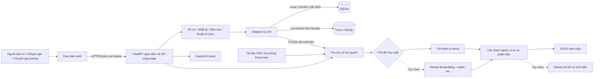
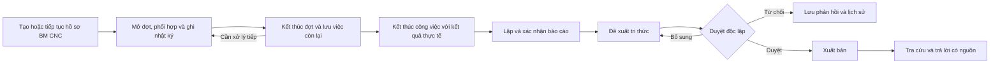
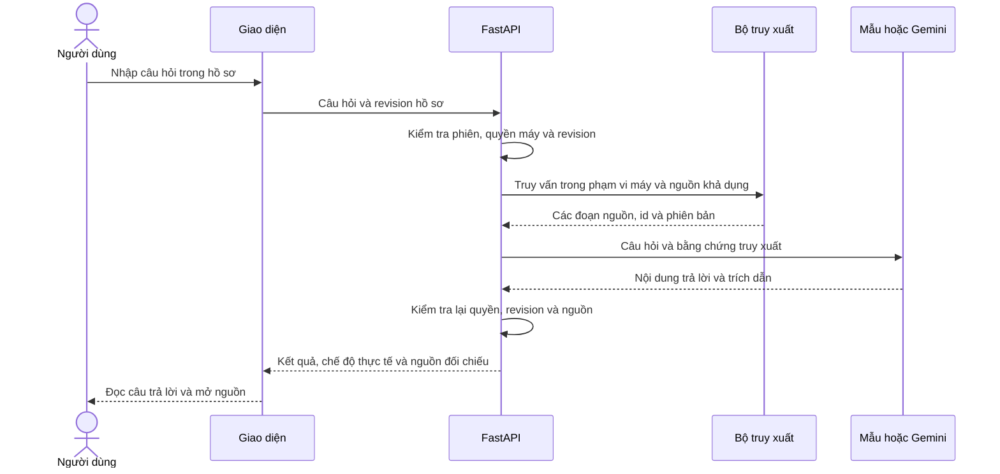
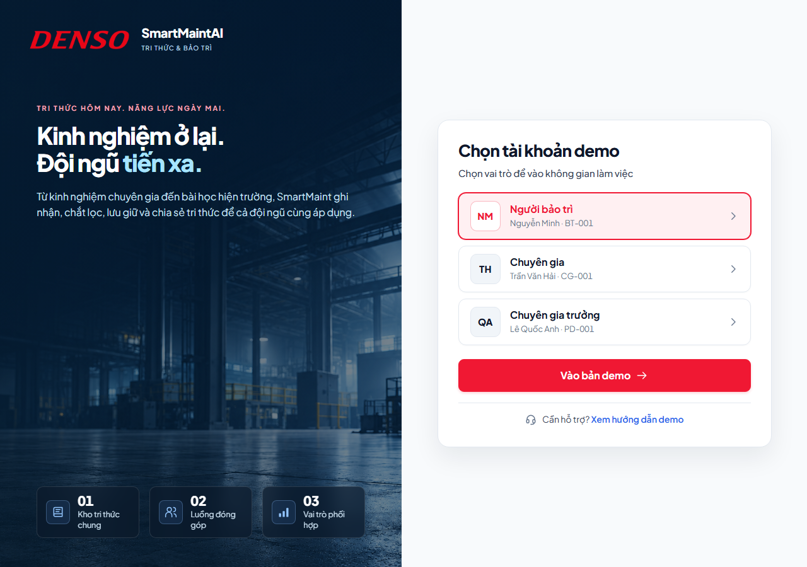
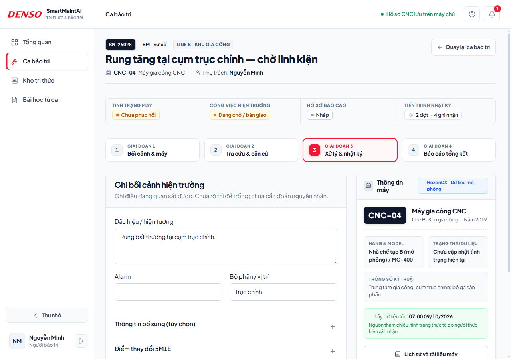
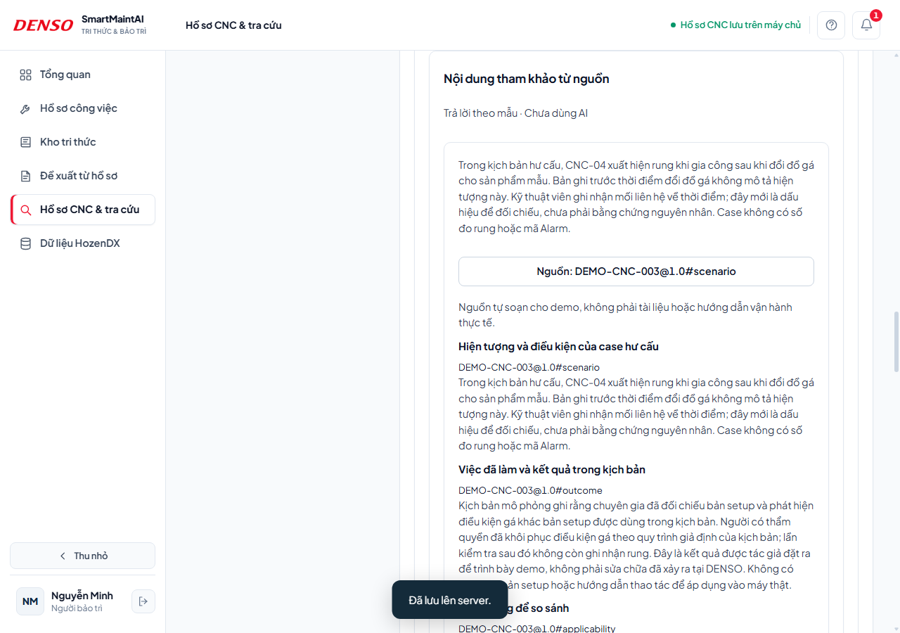
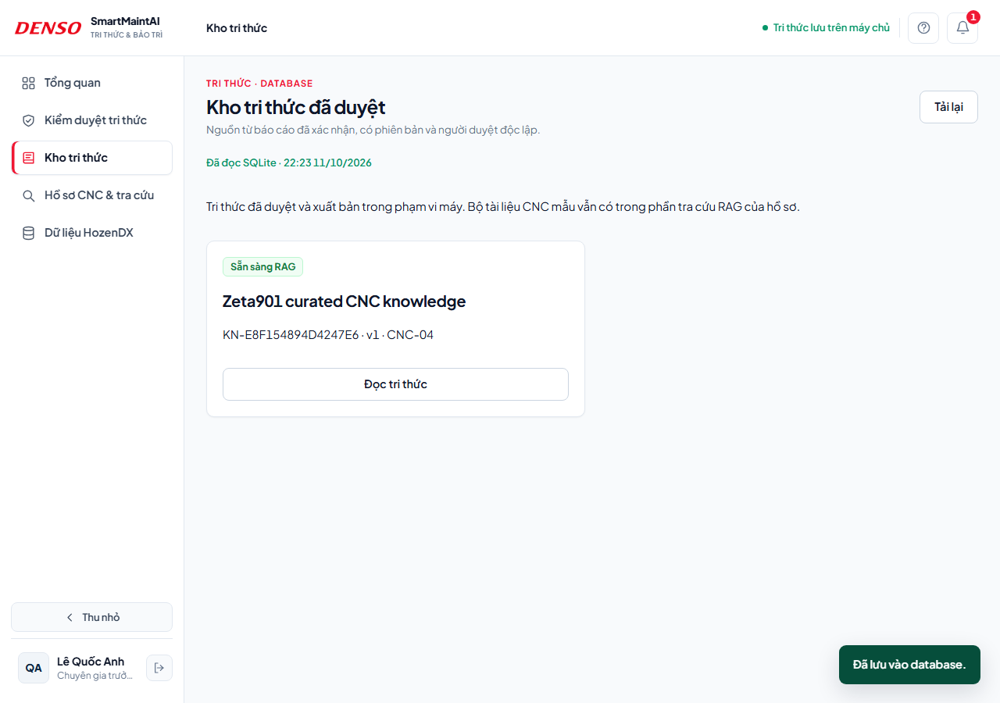

# DENSO SmartMaint — Demo bảo trì CNC và tra cứu tri thức

DENSO SmartMaint hỗ trợ nhân viên bảo trì ghi nhận sự cố CNC, phối hợp chuyên gia và tìm lại kinh nghiệm xử lý có dẫn nguồn. Thông tin từ hồ sơ công việc được tổng hợp thành báo cáo, duyệt độc lập và xuất bản vào kho tri thức để phục vụ những lần tra cứu sau.

**Bản demo hackathon đã có website công khai và có thể chạy lại bằng Docker hoặc Python.** Dữ liệu CNC là mô phỏng; kết nối HozenDX hiện dùng mock. Không cần API key để thử chế độ từ khóa/trả lời mẫu.

### Dùng thử ngay

**[Mở Live Demo DENSO SmartMaint](https://denso-smartmaint-demo.onrender.com/)** · **[Mã nguồn GitHub](https://github.com/nguyenhoangduong17122005-glitch/DENSO_Knowledge_Graph)**

Chọn **Người bảo trì — Nguyễn Minh** → **Vào bản demo** → mở **Hồ sơ công việc**. Không cần nhập mật khẩu trong chế độ trình diễn. Render Free có thể khởi động chậm sau thời gian không có truy cập; hãy mở website trước buổi thuyết trình.

Live Demo lưu nghiệp vụ trong **Turso online dùng chung**. Các thao tác lưu thành công có thể được người khác nhìn thấy trong cùng phạm vi quyền. Bản chạy local và Docker có database riêng, không tự đồng bộ với website.

[Kiến trúc](#kiến-trúc) · [Luồng dữ liệu](#luồng-dữ-liệu) · [Ảnh kết quả](#giao-diện-demo) · [Chạy nhanh bằng Docker](#chạy-bằng-docker) · [Kịch bản kiểm tra](#kịch-bản-demo) · [Chạy trên Windows](#chạy-trên-windows)

## Bài toán và cách giải quyết

Kinh nghiệm bảo trì thường nằm rải rác trong lịch sử sửa chữa, tài liệu và ghi chú của chuyên gia. Khi máy xuất hiện dấu hiệu bất thường, nhân viên cần tìm đúng thông tin, đối chiếu điều kiện và giữ được căn cứ của các bước đã thực hiện.

SmartMaint nối **hồ sơ sự cố → nhật ký theo đợt → báo cáo xác nhận → tri thức được duyệt → tra cứu có nguồn**. RAG hỗ trợ tìm lại tài liệu và kinh nghiệm; quyết định xử lý, xác nhận đóng góp và kiểm duyệt vẫn do người dùng thực hiện.

## Chức năng chính

- Tạo và lưu hồ sơ sự cố CNC, bối cảnh và các phiên bản cập nhật.
- Mời chuyên gia hỗ trợ, ghi nhật ký xử lý và xác nhận đóng góp.
- Kết thúc công việc, lập và xác nhận báo cáo.
- Tạo đề xuất tri thức từ báo cáo, duyệt độc lập và xuất bản.
- Tra cứu tài liệu/tri thức theo quyền, trả lời có trích dẫn và mở nguồn đối chiếu.

Demo mặc định **tìm kiếm từ khóa và trả lời theo mẫu**. Có thể bật **Gemini + embedding/vector** khi có API key; chế độ này là tùy chọn và được hiển thị rõ trên giao diện.

## Kiến trúc

Frontend và API được phục vụ cùng một ứng dụng FastAPI. Bản local dùng SQLite; Live Demo dùng adapter libSQL qua HTTPS để lưu dữ liệu trên Turso. Phần vector tùy chọn dùng Gemini Embedding và sqlite-vec.



| Thành phần | Công nghệ và nhiệm vụ |
| --- | --- |
| Giao diện | HTML/CSS/JavaScript; không cần build Node.js |
| API và nghiệp vụ | Python 3.14, FastAPI, Uvicorn; hồ sơ, đợt, nhật ký, báo cáo và duyệt tri thức |
| Lưu trữ local | SQLite, lịch sử phiên bản và kiểm tra revision khi ghi |
| Lưu trữ Live Demo | Turso/libSQL qua HTTPS; dữ liệu nằm ngoài container Render |
| RAG mặc định | Truy xuất từ khóa, trả lời theo mẫu và trích dẫn nguồn |
| RAG tùy chọn | Gemini Embedding, sqlite-vec và Gemini sinh câu trả lời |
| Thông tin thiết bị | Adapter HozenDX mock, chỉ hỗ trợ phạm vi máy CNC-04 của demo |

Hai chế độ lưu trữ là lựa chọn thay thế, không phải hai database tự đồng bộ. Trên Render, vector index là cache có thể tạo lại; hồ sơ và tri thức được lưu ở Turso.

## Luồng dữ liệu



Hồ sơ mới và đề xuất chưa xuất bản không tự trở thành nguồn tra cứu. Nguồn gồm tài liệu mẫu đã chuẩn bị và tri thức đã được duyệt, xuất bản thành công.

Luồng truy vấn RAG:



Tra cứu không tự sửa hồ sơ hoặc xác nhận nguyên nhân. Hiện truy vấn lấy câu hỏi người dùng và phạm vi máy, chưa tự phân tích toàn bộ nhật ký. Khi không có nguồn phù hợp, giao diện báo không tìm thấy; khi Gemini/vector không khả dụng, hệ thống có thể dùng chế độ dự phòng và hiển thị nhãn tương ứng.

Hồ sơ có ba trạng thái riêng: **máy**, **tiến độ công việc** và **báo cáo**. Máy đã phục hồi không có nghĩa nguyên nhân đã được xác nhận hoặc báo cáo đã được chốt.

## Giao diện demo

Ảnh chụp từ ứng dụng chạy thực tế với dữ liệu mô phỏng. Ảnh trả lời sử dụng chế độ từ khóa/mẫu.

**Chọn vai trò**



Chuyển giữa người bảo trì, chuyên gia và chuyên gia trưởng để kiểm tra từng phần nghiệp vụ.

**Hồ sơ công việc CNC**



Lưu bối cảnh, ghi nhận theo đợt, người thực hiện và bằng chứng; dữ liệu được đọc lại từ backend.

**Tra cứu có trích dẫn nguồn**



Kết quả có mã nguồn, phiên bản và đoạn trích để người dùng mở đối chiếu. Ảnh này không chứng minh đang gọi Gemini.

**Kho tri thức đã xuất bản**



Tri thức từ báo cáo chỉ xuất hiện sau khi chuyên gia trưởng độc lập duyệt và xuất bản thành công. Các ảnh minh họa được chụp trên môi trường kiểm thử, không phải ảnh chụp database Live Demo hiện tại.

## Chạy trên Windows

Yêu cầu: **Python 3.14**, có Python Launcher (`py`) và Internet để cài thư viện lần đầu.

1. Tải repo bằng **Code → Download ZIP** và giải nén, hoặc clone bằng Git.
2. Nhấp đúp **Cai-dat-demo.cmd** để cài thư viện và khởi tạo dữ liệu.
3. Nhấp đúp **Chay-demo.cmd**, giữ cửa sổ máy chủ mở.
4. Mở **http://127.0.0.1:8001/** → chọn **Người bảo trì — Nguyễn Minh** → **Vào bản demo**. Không cần mật khẩu.

Lần đầu tự tạo 5 hồ sơ mẫu và cấu hình từ khóa/trả lời mẫu. Các lần sau chỉ cần chạy `Chay-demo.cmd`. Dừng máy chủ bằng **Ctrl+C**.

Hoặc chạy từ Terminal tại thư mục dự án:

```powershell
py -m venv .venv
.\.venv\Scripts\python.exe -m pip install -r backend/requirements.txt
.\.venv\Scripts\python.exe -m backend.setup_demo
.\.venv\Scripts\python.exe -m backend.launch_demo
```

Nếu đã có `.env`, ứng dụng giữ cấu hình cũ. Để chạy demo không gọi Gemini và dùng database local, đặt:

```dotenv
SMARTMAINT_STORAGE=sqlite
SMARTMAINT_ANSWER_MODE=template
SMARTMAINT_RETRIEVAL_MODE=keyword
```

Sau khi sửa `.env`, dừng máy chủ và chạy lại. Không mở `index.html` trực tiếp hoặc dùng Live Server để kiểm tra lưu database.

## Chạy bằng Docker

Đây là cách chạy nhanh cho ban tổ chức tự kiểm tra. Yêu cầu: **Docker Engine/Docker Desktop đang chạy**, Docker Compose v2 và Internet để tải image/thư viện lần đầu. Không cần cài Python hoặc Node.js trên máy chủ.

Clone bản mới và chạy từ thư mục gốc:

```bash
git clone https://github.com/nguyenhoangduong17122005-glitch/DENSO_Knowledge_Graph.git
cd DENSO_Knowledge_Graph
docker compose up --build -d
docker compose ps
```

Nếu tải ZIP, giải nén rồi mở Terminal tại thư mục chứa `compose.yaml` và chạy hai lệnh Docker trên.

Chờ container sẵn sàng, mở **http://127.0.0.1:8001/** và chọn vai trò. Trên bản clone mới không có `.env`, Docker mặc định dùng **SQLite + từ khóa + trả lời mẫu**, không cần Gemini API key. App tự tạo schema, tài khoản demo và 5 hồ sơ mẫu; khởi động lại không tạo lại dữ liệu trùng.

Mở **http://127.0.0.1:8001/api/health** để kiểm tra backend. Kết quả mong đợi chứa `"status":"ok"`, `"environment":"demo"` và `"liveHozenDX":false`.

Nếu dùng thư mục đã có `.env`, Compose sẽ lấy các biến cấu hình trong đó. Để tự kiểm tra offline với database local, đặt ba biến sau trước khi chạy:

```dotenv
SMARTMAINT_STORAGE=sqlite
SMARTMAINT_ANSWER_MODE=template
SMARTMAINT_RETRIEVAL_MODE=keyword
```

```bash
# Xem log
docker compose logs --tail=80 smartmaint

# Khởi động lại để kiểm tra dữ liệu còn được lưu
docker compose restart smartmaint

# Dừng, giữ database
docker compose down
```

Database Docker được lưu trong volume `smartmaint-data`, độc lập với database chạy bằng Python. Giữ volume để giữ hồ sơ đã thêm.

Nếu cổng 8001 đang được ứng dụng khác dùng, dừng ứng dụng đó hoặc đổi cổng phía máy trong `compose.yaml`, ví dụ `127.0.0.1:8002:8001`, rồi mở cổng 8002. Nếu container chưa sẵn sàng, xem log bằng lệnh trên.

## Kịch bản demo

| Bước | Thao tác | Kết quả mong đợi |
| --- | --- | --- |
| 1 | Chọn **Người bảo trì — Nguyễn Minh**, tạo hồ sơ `DEMO-KT01: Rung sau thay dao`, máy CNC-04 | Hồ sơ có mã BM và xuất hiện lại sau khi tải trang |
| 2 | Nhập hiện tượng: “Rung tại trục chính sau thay dao; chưa xác định nguyên nhân”; xác nhận đúng máy demo và ghi lý do công việc độc lập nếu được yêu cầu | Bối cảnh được lưu; không tự kết luận nguyên nhân |
| 3 | Tra cứu “rung trục chính”, chọn trả lời từ nguồn và mở nguồn đối chiếu | Có kết quả phù hợp, nhãn chế độ trả lời và citation |
| 4 | Mời **Trần Văn Hải**; đổi sang vai trò chuyên gia để nhận hỗ trợ | Yêu cầu chuyển trạng thái và chuyên gia có quyền tham gia hồ sơ |
| 5 | Người phụ trách mở đợt nếu chưa có; ghi hiện tượng, kiểm tra, thao tác và kết quả, chọn đúng người thực hiện | Nhật ký có người ghi/người làm và phiên bản |
| 6 | Chuyên gia xác nhận các ghi nhận mình thực hiện | Xác nhận gắn đúng sự kiện và revision; không xác nhận thay người khác |
| 7 | Người phụ trách kết thúc đợt với tóm tắt và việc còn lại; kết thúc công việc với kết quả chạy thử mô phỏng | Tiến độ công việc kết thúc, báo cáo vẫn có trạng thái riêng |
| 8 | Nhập báo cáo, lưu/gửi và xác nhận tổng hợp; cập nhật nguồn báo cáo nếu nhật ký/xác nhận đã đổi | Báo cáo được chốt khi đủ điều kiện, giữ nguồn và phiên bản |
| 9 | Tạo đề xuất từ báo cáo đã xác nhận, đọc/sửa nội dung và gửi duyệt | Đề xuất ở trạng thái chờ; chưa tự trở thành nguồn RAG |
| 10 | Đổi sang **Chuyên gia trưởng — Lê Quốc Anh**, đối chiếu nguồn, duyệt và xuất bản | Tri thức sẵn sàng tra cứu sau khi xuất bản thành công |
| 11 | Quay lại người bảo trì, tìm theo từ khóa riêng của tri thức vừa xuất bản và mở citation | Truy được nguồn tri thức mới đúng id/phiên bản |

Để kiểm tra lưu dữ liệu trên bản local, tải lại trang rồi khởi động lại máy chủ/container và tìm hồ sơ theo mã BM. Database Python nằm tại `.runtime/smartmaint.sqlite3`; mở bằng SQLite Viewer để xem bảng `cases`. Database Docker nằm trong volume. Trên Live Demo, dữ liệu nằm trong Turso và dùng chung theo quyền; database local không tự upload lên cloud.

Hướng dẫn điền từng trường: [Kịch bản BM](docs/guides/BM-WORKFLOW-DEMO.md) · [Duyệt và xuất bản tri thức](docs/guides/KNOWLEDGE-RAG-DEMO.md).

## Cấu trúc dự án

```text
frontend/          Giao diện, hình ảnh, CSS và font
backend/           API, nghiệp vụ và kết nối database
  rag/             Tìm kiếm, embedding và trả lời
  tools/           Kiểm tra và xuất dữ liệu
  tests/           Kiểm thử tự động
  migrations/      Nâng cấp schema SQLite
fixtures/          Dữ liệu CNC, HozenDX và tài liệu mô phỏng
docs/              Hướng dẫn, thiết kế và ảnh kết quả
scripts/           Script Windows tùy chọn và CI
Dockerfile         Đóng gói frontend và backend
compose.yaml       Chạy local bằng Docker, giữ dữ liệu trong volume
render.yaml        Cấu hình Render Free + Turso cho Live Demo
Cai-dat-demo.cmd   Cài đặt lần đầu
Chay-demo.cmd      Chạy ứng dụng
```

`.env`, `.venv` và `.runtime` được tạo trên máy người dùng, không đưa lên GitHub. Xem [bản đồ file theo công việc](docs/PROJECT-STRUCTURE.md).

## Kiểm thử và phạm vi demo

| Kiểm chứng | Bằng chứng và giới hạn |
| --- | --- |
| Bộ kiểm thử trước bản sửa hosting | 170 bài đạt; gồm nghiệp vụ, phân quyền, revision và RAG |
| Bản sửa Turso `0d5e02c` | 17 kiểm thử adapter đạt, gồm đóng luồng autocommit, giao dịch, lưu qua khởi động lại và luồng BM → tri thức → RAG |
| Kiểm tra luồng với sơ đồ | 55 kiểm thử hồ sơ, nhật ký, báo cáo, tri thức và tìm kiếm đạt trong lần rà soát ngày 11/10/2026 |
| Tra cứu mẫu | 10/10 câu hỏi demo đạt; đây là kiểm tra chức năng, không phải benchmark chất lượng AI độc lập |
| Giao diện | Đã chạy browser smoke bằng Edge trên database/profile kiểm thử riêng |
| Docker và libSQL | Đã kiểm tra build/chạy, lưu dữ liệu và luồng nghiệp vụ trong [GitHub Actions](https://github.com/nguyenhoangduong17122005-glitch/DENSO_Knowledge_Graph/actions/workflows/docker-smoke.yml) |
| Website công khai | Render báo Live với commit `0d5e02c`; `/api/health` trả `status: ok` khi kiểm tra ngày 11/10/2026; chưa coi đây là kiểm thử thủ công mọi chức năng trên cloud |

Chạy lại bộ kiểm thử:

```powershell
.\.venv\Scripts\python.exe -m pip install -r backend/requirements-dev.txt
.\.venv\Scripts\python.exe -m pytest backend/tests -q
.\.venv\Scripts\python.exe -m backend.tools.demo_check
```

Phạm vi hiện tại là bảo trì sự cố **BM CNC** trên dữ liệu mô phỏng. Các giới hạn cần đọc cùng kết quả demo:

- HozenDX chưa kết nối thật; PM và thông báo chưa đồng bộ đầy đủ với backend.
- Gemini hiện hỗ trợ trả lời từ nguồn; chưa có AI soạn báo cáo hoặc AI tóm tắt bàn giao trong backend.
- Tri thức từ báo cáo hỗ trợ tạo mới; chưa có đầy đủ luồng nhập kinh nghiệm trực tiếp, đối chiếu trùng, cập nhật/liên kết tri thức cũ.
- Báo cáo hiện được lập sau khi kết thúc công việc; chưa có đầy đủ xem nháp lúc đang làm và đính chính sau chốt theo sơ đồ.
- Bộ chọn vai trò và các tài khoản dùng chung phục vụ trình diễn, chưa thay thế xác thực production. Các màn hình ghi rõ mô phỏng trên trình duyệt chưa lưu vào database nghiệp vụ.

Xem [đối chiếu 5 trang BPMN và 16 sơ đồ tuần tự](docs/design/WORKFLOW-CONFORMANCE.md) để phân biệt phần đã thực hiện và phần còn thiếu.

## Tài liệu thêm

- [Cấu hình Gemini và vector — tùy chọn](docs/guides/DENSO-RAG-VECTOR-GEMINI.md)
- [Dữ liệu mẫu và câu hỏi gợi ý](docs/guides/DENSO-DEMO-SAMPLE-DATA.md)
- [Triển khai Live Demo bằng Render + Turso](docs/guides/LIVE-DEMO-DEPLOYMENT.md)
- [Hướng dẫn backend](backend/README.md)
- [Mục lục tài liệu](docs/README.md)
