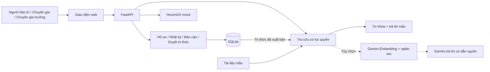
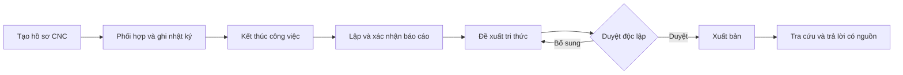

# DENSO SmartMaint — Demo bảo trì CNC và tra cứu tri thức

DENSO SmartMaint hỗ trợ nhân viên bảo trì ghi nhận sự cố CNC, phối hợp chuyên gia và tìm lại kinh nghiệm xử lý có dẫn nguồn. Thông tin từ hồ sơ công việc được tổng hợp thành báo cáo, duyệt độc lập và xuất bản vào kho tri thức để phục vụ những lần tra cứu sau.

**Bản nộp hackathon chạy local trên trình duyệt.** Không cần deploy hoặc API key để dùng thử. Dữ liệu CNC là mô phỏng; kết nối HozenDX hiện dùng mock.

[Chạy trên Windows](#chạy-trên-windows) · [Chạy bằng Docker](#chạy-bằng-docker) · [Kịch bản demo](#kịch-bản-demo)

## Chức năng chính

- Tạo và lưu hồ sơ sự cố CNC, bối cảnh và các phiên bản cập nhật.
- Mời chuyên gia hỗ trợ, ghi nhật ký xử lý và xác nhận đóng góp.
- Kết thúc công việc, lập và xác nhận báo cáo.
- Tạo đề xuất tri thức từ báo cáo, duyệt độc lập và xuất bản.
- Tra cứu tài liệu/tri thức theo quyền, trả lời có trích dẫn và mở nguồn đối chiếu.

Demo mặc định **tìm kiếm từ khóa và trả lời theo mẫu**. Có thể bật **Gemini + embedding/vector** khi có API key; chế độ này là tùy chọn và được hiển thị rõ trên giao diện.

## Kiến trúc

Frontend dùng HTML/CSS/JavaScript, backend dùng FastAPI, dữ liệu nghiệp vụ lưu trong SQLite. Phần vector tùy chọn dùng Gemini Embedding và sqlite-vec.



## Luồng dữ liệu



Hồ sơ mới và đề xuất chưa xuất bản không tự trở thành nguồn tra cứu. Nguồn gồm tài liệu mẫu đã chuẩn bị và tri thức đã được duyệt, xuất bản thành công.

## Giao diện demo

Ảnh chụp từ ứng dụng chạy thực tế với dữ liệu mô phỏng. Ảnh trả lời sử dụng chế độ từ khóa/mẫu.

<details>
<summary>Xem 4 màn hình minh họa</summary>

**Chọn vai trò**


**Hồ sơ công việc CNC**


**Tra cứu có trích dẫn nguồn**


**Kho tri thức đã xuất bản**


</details>

## Chạy trên Windows

Yêu cầu: **Python 3.14**, có Python Launcher (`py`) và Internet để cài thư viện lần đầu.

1. Tải repo bằng **Code → Download ZIP** và giải nén, hoặc clone bằng Git.
2. Nhấp đúp **Cai-dat-demo.cmd** để cài thư viện và khởi tạo dữ liệu.
3. Nhấp đúp **Chay-demo.cmd**, giữ cửa sổ máy chủ mở.
4. Mở **http://127.0.0.1:8001/** → chọn **Người bảo trì — Nguyễn Minh** → **Vào bản demo**. Không cần mật khẩu.

Lần đầu tự tạo 5 hồ sơ mẫu và cấu hình từ khóa/trả lời mẫu. Các lần sau chỉ cần chạy `Chay-demo.cmd`. Dừng máy chủ bằng **Ctrl+C**.

Hoặc chạy từ Terminal tại thư mục dự án:

```powershell
py -m venv .venv
.\.venv\Scripts\python.exe -m pip install -r backend/requirements.txt
.\.venv\Scripts\python.exe -m backend.setup_demo
.\.venv\Scripts\python.exe -m backend.launch_demo
```

Nếu đã có `.env`, ứng dụng giữ cấu hình cũ. Để chạy demo không gọi Gemini và dùng database local, đặt:

```dotenv
SMARTMAINT_STORAGE=sqlite
SMARTMAINT_ANSWER_MODE=template
SMARTMAINT_RETRIEVAL_MODE=keyword
```

Sau khi sửa `.env`, dừng máy chủ và chạy lại. Không mở `index.html` trực tiếp hoặc dùng Live Server để kiểm tra lưu database.

## Chạy bằng Docker

Yêu cầu: Docker và Docker Compose. Từ thư mục dự án:

```bash
docker compose up --build -d
```

Mở **http://127.0.0.1:8001/** và chọn vai trò. Không có `.env`, Docker mặc định dùng SQLite, từ khóa và trả lời mẫu.

```bash
# Xem log
docker compose logs -f smartmaint

# Dừng, giữ database
docker compose down
```

Database Docker được lưu trong volume `smartmaint-data`, độc lập với database chạy bằng Python. Giữ volume để giữ hồ sơ đã thêm.

## Kịch bản demo

1. Chọn **Người bảo trì**, mở hồ sơ CNC mẫu hoặc tạo sự cố mới.
2. Nhập hiện tượng, ví dụ: “Rung tại trục chính sau thay dao; chưa xác định nguyên nhân”.
3. Tra cứu “rung trục chính”, xem câu trả lời và mở nguồn đối chiếu.
4. Mời chuyên gia, đổi vai trò để nhận hỗ trợ và ghi nhật ký xử lý.
5. Kết thúc công việc, lập và xác nhận báo cáo, tạo đề xuất tri thức.
6. Đổi sang **Chuyên gia trưởng**, duyệt độc lập và xuất bản; quay lại tra cứu tri thức vừa xuất bản.

Để kiểm tra lưu dữ liệu, tạo hồ sơ có tên riêng, tải lại trang rồi khởi động lại máy chủ và tìm lại hồ sơ. Database Python nằm tại `.runtime/smartmaint.sqlite3`; mở bằng SQLite Viewer để xem bảng `cases`.

Hướng dẫn điền từng trường: [Kịch bản BM](docs/guides/BM-WORKFLOW-DEMO.md) · [Duyệt và xuất bản tri thức](docs/guides/KNOWLEDGE-RAG-DEMO.md).

## Cấu trúc dự án

```text
frontend/          Giao diện, hình ảnh, CSS và font
backend/           API, nghiệp vụ và kết nối database
  rag/             Tìm kiếm, embedding và trả lời
  tools/           Kiểm tra và xuất dữ liệu
  tests/           Kiểm thử tự động
  migrations/      Nâng cấp schema SQLite
fixtures/          Dữ liệu CNC, HozenDX và tài liệu mô phỏng
docs/              Hướng dẫn, thiết kế và ảnh kết quả
scripts/           Script Windows tùy chọn và CI
Cai-dat-demo.cmd   Cài đặt lần đầu
Chay-demo.cmd      Chạy ứng dụng
```

`.env`, `.venv` và `.runtime` được tạo trên máy người dùng, không đưa lên GitHub. Xem [bản đồ file theo công việc](docs/PROJECT-STRUCTURE.md).

## Kiểm thử và phạm vi demo

Đã kiểm tra: **170 bài kiểm thử tự động**, **10/10 câu hỏi demo** và luồng giao diện bằng Edge. Docker và kết nối libSQL đã được kiểm tra trong [GitHub Actions](https://github.com/nguyenhoangduong17122005-glitch/DENSO_Knowledge_Graph/actions/workflows/docker-smoke.yml). Bộ câu hỏi demo là dữ liệu kiểm tra chức năng, không phải benchmark chất lượng AI độc lập.

Chạy lại bộ kiểm thử:

```powershell
.\.venv\Scripts\python.exe -m pip install -r backend/requirements-dev.txt
.\.venv\Scripts\python.exe -m pytest backend/tests -q
.\.venv\Scripts\python.exe -m backend.tools.demo_check
```

Phạm vi hiện tại là bảo trì sự cố BM trên dữ liệu mô phỏng. HozenDX chưa kết nối thật; PM và thông báo chưa đồng bộ đầy đủ với backend. Bộ chọn vai trò phục vụ trình diễn, chưa thay thế xác thực production.

## Tài liệu thêm

- [Cấu hình Gemini và vector — tùy chọn](docs/guides/DENSO-RAG-VECTOR-GEMINI.md)
- [Dữ liệu mẫu và câu hỏi gợi ý](docs/guides/DENSO-DEMO-SAMPLE-DATA.md)
- [Hướng dẫn backend](backend/README.md)
- [Mục lục tài liệu](docs/README.md)
