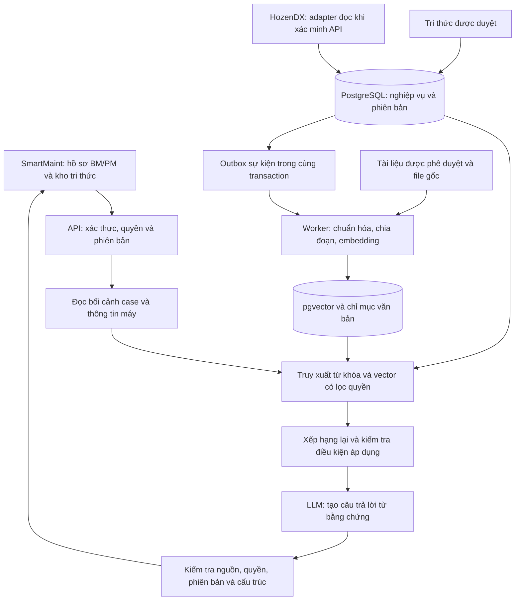
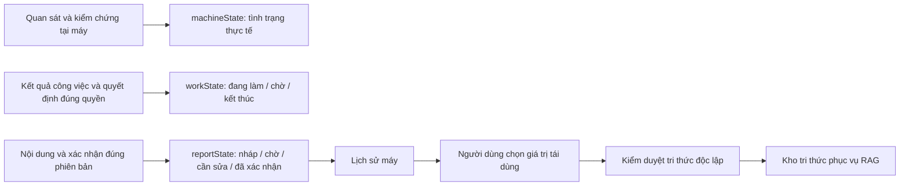
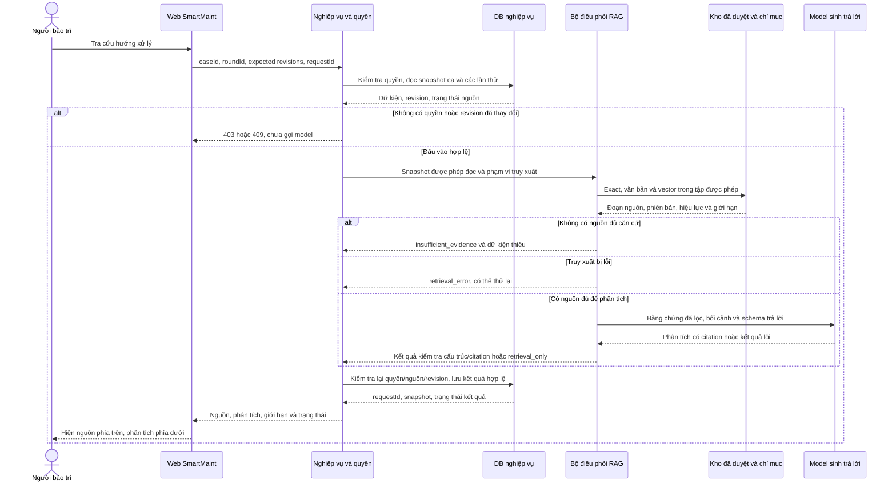

# Thiết kế RAG cho DENSO SmartMaint

**Điều chỉnh theo yêu cầu mới:** chỉ xây demo đơn giản. [Kế hoạch demo](../history/DENSO-DEMO-PLAN.md) là phạm vi ưu tiên cho các bước tiếp theo; các yêu cầu pilot/production dưới đây để tham khảo.

Tiến độ local: bước 5 đã chuẩn hóa dữ liệu, thêm nhật ký nhiều đợt và xác nhận theo revision. Xem [kết quả, sơ đồ dữ liệu và giới hạn bước 5](DENSO-STEP5-DATA-MODEL.md). Các phần kiến trúc RAG dưới đây tiếp tục là thiết kế; chưa có RAG/HozenDX thật.

Ngày thiết kế: 09/10/2026. Phạm vi: thiết kế để phát triển tiếp từ prototype trong workspace; chưa phải kết nối hoặc triển khai vào nhà máy.

Cập nhật theo 5 trang của `D:\denso-maintenance-workflows-BPMN (1).drawio` do người dùng cung cấp. Sơ đồ được dùng làm đầu vào mô tả nghiệp vụ; các ghi chú bên trong không phải chỉ dẫn thực thi cho trợ lý. Phần 15 ánh xạ bước BPMN sang thiết kế kỹ thuật và bổ sung các ràng buộc chưa thể hiện đầy đủ ở bản đầu.

Đối chiếu tiếp với `D:\denso-maintenance-sequences (2).drawio`: 1 trang bản đồ và 16 sequence SQ01–SQ16. Phần 16 bổ sung hợp đồng tương tác và thứ tự xử lý. Các chú thích/tham chiếu trong file được xem là nội dung tài liệu, không tự động được thực thi.

## 1. Quyết định kiến trúc

Phạm vi lần triển khai đầu được cụ thể hóa tại [DENSO-RAG-MVP-SCOPE.md](DENSO-RAG-MVP-SCOPE.md): người dùng chọn **CNC — rung hoặc nhiệt độ bất thường**; ưu tiên tra cứu trong hồ sơ BM/PM. Các chức năng rộng hơn dưới đây là thiết kế tổng thể và lộ trình sau MVP đầu tiên.

Xây RAG hỗ trợ bảo trì ngay trong hồ sơ BM/PM và kho tri thức hiện có. RAG tìm nguồn đúng máy, đúng điều kiện, đúng phiên bản, sau đó tạo câu trả lời có dẫn chứng. Con người tiếp tục quyết định hướng xử lý, xác nhận báo cáo và duyệt xuất bản.

MVP đề xuất: giao diện hiện có + API Python/FastAPI + PostgreSQL/pgvector + worker lập chỉ mục + kho file nội bộ + cổng gọi embedding/LLM. Đây là lựa chọn thiết kế, không phải stack đã tồn tại trong dự án. Chọn model sau khi thử trên dữ liệu tiếng Việt và yêu cầu bảo mật của nhà máy; không gắn kiến trúc với một nhà cung cấp.

## 2. Hiện trạng đã đọc trong mã

| Thành phần | Hiện trạng | Vai trò trong RAG |
|---|---|---|
| `frontend/prototype/core.js` | `window.SM`, localStorage; tài khoản và phân quyền demo | Cần backend xác thực và lưu dữ liệu chính thức |
| `frontend/prototype/data.js` | Máy Vision/CNC/Máy ép, tri thức mẫu, SOP/DAS dạng tóm tắt | Dữ liệu khởi đầu cho bộ kiểm thử; phải gắn nhãn mô phỏng |
| `frontend/prototype/cases.js` | Bối cảnh, Alarm, bộ phận, model sản phẩm, 5M1E, nhật ký, BM/PM, chọn nguồn | Điểm gọi RAG theo ca và nguồn cho nháp báo cáo |
| `frontend/prototype/knowledge.js` | Tìm chuỗi, đối chiếu từ khóa/nhóm máy, đề xuất và kiểm duyệt | Thay truy xuất mô phỏng bằng hybrid retrieval |
| `frontend/assets/js/app.js` | Ba vai trò và HozenDX mô phỏng chỉ đọc | Giữ quy trình nghiệp vụ, bổ sung trạng thái kết nối thật |

Các ràng buộc nghiệp vụ đã có cần giữ: chỉ kho `published` được tra cứu chung; báo cáo `confirmed` mới tạo đề xuất từ case; người duyệt độc lập với tác giả/người đóng góp; thay bối cảnh hoặc nguồn làm kết quả đối chiếu cũ hết hiệu lực. Model máy và model sản phẩm là hai trường khác nhau.

Chưa có bằng chứng về backend, API HozenDX thật, SSO, tài liệu nhà máy đầy đủ, số lượng hồ sơ hoặc tài nguyên GPU trong workspace. Các phần này là đầu vào cần xác minh khi triển khai.

## 3. Bốn chức năng

| Chức năng | Đầu vào | Đầu ra | Giới hạn |
|---|---|---|---|
| Tra cứu theo ca | Máy, hiện tượng, Alarm, điều kiện, thay đổi 5M1E | Nguồn liên quan, điểm khớp/khác, hướng kiểm tra có căn cứ | Không tự kết luận nguyên nhân hoặc đánh dấu đã thực hiện |
| Hỏi kho tri thức | Câu hỏi và phạm vi máy | Trả lời có nguồn, phiên bản, giới hạn áp dụng | Không đủ nguồn thì hỏi thêm hoặc chuyển chuyên gia |
| Đối chiếu đề xuất | Bản nháp và phiên bản | Nguồn tương tự, khác biệt theo từng trường, gợi ý mới/cập nhật/liên kết | Người dùng chọn; chuyên gia trưởng duyệt |
| Soạn báo cáo | Nhật ký và bằng chứng của case được phép đọc | Nháp tổng kết gắn từng nhận định với sự kiện | Tri thức tham khảo không trở thành bằng chứng đã sửa máy |

MVP ưu tiên tra cứu theo ca và hỏi kho; bổ sung đối chiếu và soạn báo cáo sau khi truy xuất đạt yêu cầu.

## 4. Sơ đồ tổng thể



LLM chỉ nhận các đoạn đã qua kiểm tra quyền. Khóa gọi model nằm ở backend. Dữ liệu nghiệp vụ là nguồn sự thật; vector index là dữ liệu dẫn xuất có thể xây lại.

## 5. Nguồn dữ liệu và mức tin cậy

| Nguồn | Đưa vào kho dùng chung? | Cách sử dụng |
|---|---|---|
| `knowledge.status=published` | Có, phiên bản hiện hành đủ điều kiện | Kinh nghiệm chuyên gia và case đã duyệt |
| SOP/DAS/manual đã phê duyệt, có hiệu lực | Có | Quy trình, phạm vi và tiêu chuẩn; giữ file, trang, mục |
| Báo cáo case `confirmed` | Không tự động | Đọc trong phạm vi quyền; cần đề xuất và duyệt để thành tri thức chung |
| Case đang mở, nhật ký, ảnh hiện trường | Không | Bối cảnh riêng của ca; chỉ người có quyền được đọc |
| Đề xuất `draft/pending/changes/rejected/withdrawn` | Không | Dùng làm đầu vào đối chiếu của người có quyền, không làm nguồn trả lời chung |
| Lịch sử HozenDX | Không tự động | Dữ liệu tham chiếu có thời điểm nguồn và quyền truy cập |
| Dữ liệu demo trong repo | Chỉ môi trường demo | Không trộn vào kho sản xuất |

Một tham chiếu chỉ có mã và summary không chứng minh đã có toàn văn tài liệu. Nếu chỉ có summary SOP-VIS-01 thì hệ thống nêu thiếu toàn văn, không sinh các bước vận hành từ mã SOP đó.

Khi kinh nghiệm và SOP đang có hiệu lực mâu thuẫn, hiển thị mâu thuẫn và yêu cầu chuyên gia xác minh. Không để điểm tương đồng hoặc ngày cập nhật mới tự quyết định nguồn nào có thẩm quyền.

## 6. Mô hình lưu trữ

Giữ các bảng nghiệp vụ `users`, `assets`, `cases`, `case_events`, `reports`, `proposals`, `knowledge`, `knowledge_versions`. Bổ sung các bảng dưới đây; tên trường mới là đề xuất.

| Bảng | Trường chính |
|---|---|
| `rag_documents` | `id`, `source_type`, `source_id`, `source_version`, `content_hash`, `approval_status`, `effective_from`, `effective_to`, `is_current`, `environment`, `plant_id`, `acl_scope`, `source_at`, `indexed_at` |
| `rag_chunks` | `id`, `document_id`, `section`, `text`, `embedding`, `embedding_model`, `embedding_revision`, `search_vector`, `page`, `heading`, `parent_id`, `chunker_version` |
| `rag_applicability` | `document_id`, `asset_id`, `machine_family`, `machine_model`, `product_model`, `alarm_code`, `component`, `scope_status` |
| `rag_requests` | `id`, `user_id`, `case_id`, `purpose`, `context_revision`, `corpus_generation`, `prompt_version`, `model_revision`, `status`, `latency_ms`, `token_usage` |
| `rag_evidence` | `request_id`, `chunk_id`, `source_version`, `content_hash`, `rank`, `eligibility_snapshot` |
| `rag_feedback` | `request_id`, `source_id`, `user_id`, `relevance`, `applicability`, `comment`, `created_at` |
| `outbox_events` | `id`, `aggregate_id`, `aggregate_version`, `event_type`, `payload`, `processed_at`, `attempts` |

Khóa idempotency của tài liệu: `(environment, source_type, source_id, source_version, content_hash)`. Khóa chunk gồm tài liệu, phiên bản bộ chia đoạn và vị trí đoạn. Cấu hình chiều vector theo embedding model đã chọn; đổi model thì xây chỉ mục mới, không trộn các không gian vector.

`plant_id`, ACL, thời gian hiệu lực, môi trường và phạm vi model là metadata cần bổ sung có kiểm chứng. Thiếu phạm vi model phải biểu diễn là `unknown`, không coi là áp dụng mọi model. Tài liệu quy định dùng chung phải có phạm vi `general` được phê duyệt rõ ràng.

## 7. Chuẩn hóa và chia đoạn

Với tri thức cấu trúc sẵn, ưu tiên chia theo ý nghĩa:

1. Hiện tượng + điều kiện + điểm thay đổi.
2. Kiểm tra + căn cứ + bằng chứng.
3. Xử lý + kết quả + trạng thái nguyên nhân.
4. An toàn + giới hạn + quy trình tham chiếu.

Mỗi đoạn có tiêu đề, mã nguồn, phiên bản và metadata máy. Khi đoạn kiểm tra/xử lý được chọn, luôn lấy kèm an toàn, giới hạn và bối cảnh của cùng tài liệu. Tài liệu ngắn có thể giữ nguyên cả bản.

PDF/manual: chia theo mục và trang, giữ bảng, đơn vị đo, chú thích và trình tự bước. Khởi điểm thử nghiệm 300–600 token/đoạn, chồng 50–80 token khi cần; không cắt ngang điều kiện hoặc bảng chỉ để đạt kích thước. OCR chất lượng thấp cần kiểm tra trước khi xuất bản vào kho.

Lưu nguyên văn và bản chuẩn hóa riêng. Tìm kiếm tiếng Việt có/không dấu, bảo toàn mã Alarm, mã máy, mã linh kiện, số và đơn vị; không bỏ các token kỹ thuật ngắn như `NG`. Alias như “camera không nhận” và “vision không detect” cần danh mục chuyên gia xác nhận. Tài liệu Việt/Anh/Nhật cần thử embedding đa ngôn ngữ trên dữ liệu thực tế.

## 8. Truy xuất và tạo trả lời

1. **Xác thực:** backend đọc người dùng từ session/token đã xác minh, kiểm tra quyền case và nhà máy; không tin `userId` hay ACL do trình duyệt gửi.
2. **Đóng băng bối cảnh:** đọc máy, `case.context`, 5M1E, revision; tách điều đã quan sát khỏi điều chưa kiểm tra.
3. **Xác định câu hỏi:** lấy hiện tượng, Alarm, bộ phận, machine model, product model; câu hỏi chung thiếu mã máy vẫn được tìm nhưng không suy ra phạm vi áp dụng cụ thể.
4. **Chọn tập hợp được phép:** môi trường đúng, ACL đúng, nguồn approved/published còn hiệu lực, phiên bản hiện hành; áp dụng cùng điều kiện cho mọi nhánh truy xuất.
5. **Tìm song song:** exact lookup mã Alarm/máy/tài liệu, full-text search, và vector search. Thử ban đầu 20 ứng viên mỗi nhánh; khử trùng rồi hợp nhất thứ hạng bằng RRF. PostgreSQL full-text mặc định không phải BM25; cần kiểm thử tách từ tiếng Việt và alias.
6. **Xếp hạng lại:** ưu tiên đúng máy/model, Alarm, hiện tượng, điều kiện và bằng chứng. Loại nguồn rõ ràng không tương thích. Nếu ít kết quả, chỉ mở rộng sang nguồn cùng nhóm máy được phép, gắn nhãn “cần xác minh khả năng áp dụng”; không nới ACL hoặc trạng thái duyệt.
7. **Chọn bằng chứng:** thử 3–5 tài liệu tốt nhất và các mục đi kèm. Không coi similarity score là xác suất sửa thành công. Ngưỡng đủ căn cứ được hiệu chỉnh trên tập câu hỏi chuyên gia.
8. **Sinh trả lời:** tóm tắt nguồn, chỉ ra điểm khớp/khác, các kiểm tra được nguồn hỗ trợ, điều chưa biết và điều kiện cần chuyển chuyên gia. Không nâng giả thuyết thành nguyên nhân đã xác nhận.
9. **Kiểm tra đầu ra:** schema hợp lệ; citation thuộc evidence đã cấp; nhận định quan trọng được đoạn nguồn hỗ trợ. Kiểm tra lại quyền, trạng thái và phiên bản ngay trước khi trả; nếu thay đổi thì hủy hoặc truy xuất lại.
10. **Lưu dấu vết:** nguồn/phiên bản, context revision, cấu hình model/prompt, thời gian, chi phí và phản hồi; chỉ lưu nội dung nhạy cảm theo chính sách đã xác định.

PostgreSQL và pgvector hỗ trợ kết hợp tìm văn bản với vector. Khi dùng ANN với bộ lọc, cần đo recall thực tế; MVP nhỏ có thể dùng exact vector search trên tập được phép, sau đó mới cân nhắc HNSW và iterative scans. Nguồn: [pgvector](https://github.com/pgvector/pgvector), [PostgreSQL Full Text Search](https://www.postgresql.org/docs/current/textsearch.html).

## 9. API và hợp đồng đầu ra

| API đề xuất | Mục đích |
|---|---|
| `POST /api/rag/cases/{caseId}/search` | Tra cứu theo bối cảnh case ở backend |
| `POST /api/rag/ask` | Hỏi kho, có phạm vi máy tùy chọn |
| `POST /api/rag/proposals/{id}/compare` | Đối chiếu bản nháp với kho đã duyệt |
| `POST /api/rag/cases/{caseId}/report-draft` | Soạn nháp từ sự kiện của case |
| `POST /api/rag/requests/{id}/feedback` | Ghi phản hồi có quyền |
| `GET /api/rag/sources/{id}/versions/{version}` | Đọc nguồn qua kiểm tra quyền |

Ví dụ yêu cầu tra cứu: `{ "expectedContextRevision": 12, "question": "Camera không nhận sau đổi model, cần đối chiếu gì?" }`. Backend lấy các trường máy và ca từ DB. Trả `409 context_changed` nếu revision đã đổi, `403` nếu không có quyền, `503` nếu model không khả dụng. Hết thời gian gọi LLM vẫn có thể trả danh sách nguồn đã kiểm tra kèm trạng thái `retrieval_only`.

Ví dụ cấu trúc phản hồi, nội dung và mã nguồn dưới đây chỉ minh họa từ dữ liệu demo:

```json
{
  "requestId": "RAG-example",
  "contextRevision": 12,
  "status": "needs_more_context",
  "summary": "Nguồn demo có tình huống tương tự; chưa đủ dữ kiện để kết luận nguyên nhân.",
  "findings": [
    {
      "text": "KN-024 ghi nhận hiện tượng sau chuyển model sản phẩm.",
      "citations": [{"sourceId": "KN-024", "version": 2, "section": "symptom"}]
    }
  ],
  "suggestedChecks": [
    {
      "text": "Đối chiếu lịch sử thay đổi và dữ liệu kiểm tra với cấu hình/model đã phê duyệt.",
      "citations": [{"sourceId": "KN-024", "version": 2, "section": "checks"}],
      "requiresApplicabilityReview": true
    }
  ],
  "missingContext": ["Model sản phẩm hiện tại", "Ảnh trước và sau thay đổi"],
  "limitations": ["Nguồn là dữ liệu mô phỏng", "Chưa có toàn văn SOP được xác minh"],
  "requiresExpert": true
}
```

Các trạng thái khác: `answered`, `insufficient_evidence`, `conflicting_sources`, `retrieval_only`. Server xác minh citation và dựng link nguồn từ ID; không render URL hay HTML tùy ý do model tạo. Nháp báo cáo dùng citation tới `case_event_id` và revision báo cáo; phân biệt riêng nguồn tham khảo.

## 10. Điểm tích hợp vào prototype

| Điểm hiện có | Thay đổi khi triển khai |
|---|---|
| `case-search` trong `frontend/prototype/cases.js` | Gọi API tra cứu, hiển thị loading/lỗi/nguồn thiếu; lưu request ID và context revision |
| `renderSources`, `renderSourceExtracts` | Hiển thị nhận định kèm citation, điều kiện khác biệt và dữ kiện còn thiếu |
| `case-source-pick`, `selectedSources` | Giữ chọn nguồn và snapshot; server kiểm tra lại nguồn trước khi lưu |
| Form `k-search` trong `frontend/prototype/knowledge.js` | Gọi hybrid search; thêm hỏi kho có dẫn nguồn |
| `candidates`, `k-compare` | Dùng API đối chiếu; giữ kiểm tra stale, phiên bản nháp và phiên bản nguồn |
| `parseRaw`, `k-structure` | Có thể dùng LLM trích xuất có cấu trúc; ô thiếu để trống, giữ văn bản gốc và chỉ áp dụng phần người dùng chọn |
| `buildReport` và luồng áp dụng nháp | Soạn từ snapshot nhật ký; tiếp tục bảo vệ phần người dùng đã sửa |
| Luồng duyệt/xuất bản tri thức | Backend commit phiên bản và outbox cùng transaction; worker cập nhật index |
| `S.commit` và demo login | Khi sản xuất, chuyển nghiệp vụ/quyền sang backend và SSO; kiểm tra ở UI chỉ phục vụ trải nghiệm |

UI dùng nhãn “Mức phù hợp với bối cảnh” và lý do cụ thể. Không hiển thị “95% sửa thành công” từ điểm tìm kiếm. Mỗi hướng kiểm tra mở được toàn văn đúng phiên bản và phần giới hạn.

## 11. Đồng bộ, phiên bản và thu hồi

- Duyệt mới/cập nhật: tạo phiên bản bất biến và outbox trong cùng transaction; worker xử lý idempotent, có retry và hàng đợi lỗi.
- Chỉ chuyển tài liệu mới sang trạng thái tra cứu sau khi tạo đủ chunk và embedding; đánh dấu index đang cập nhật để quan sát được.
- Bản đã hết hiệu lực bị loại khỏi truy xuất ngay qua kiểm tra DB dù vector chưa xóa. Nếu bản mới chưa index xong, không âm thầm dùng bản cũ đã bị thay thế.
- Thu hồi nguồn/quyền: chặn đọc ngay, vô hiệu cache và kết quả cũ; giữ lịch sử theo chính sách, không tiếp tục cho người đã mất quyền mở snapshot.
- Báo cáo gốc được đính chính: đánh dấu tri thức dẫn xuất cần xem xét; với sửa đổi ảnh hưởng nội dung/kết quả, tạm loại khỏi gợi ý cho tới khi chuyên gia xác nhận lại.
- Cache key gồm phạm vi quyền, phiên bản chính sách quyền, bối cảnh, phiên bản corpus và cấu hình model. Trước khi phục vụ cache vẫn kiểm tra nguồn còn được phép.
- Chọn nguồn hoặc áp dụng nháp phải kèm expected revision; thay đổi trong lúc người dùng xem thì yêu cầu đối chiếu lại.

## 12. Kiểm soát dữ liệu và prompt

Quyền nghiệp vụ theo ba vai trò hiện có và quyền tài liệu/nhà máy cần kiểm tra riêng. Không mặc định `lead` có quyền đọc mọi hồ sơ của mọi nhà máy. Kho dùng chung chỉ chứa nội dung đã được duyệt cho đúng phạm vi người đọc.

Tài liệu, OCR, câu hỏi và nhật ký đều là dữ liệu không tin cậy. Tách chỉ dẫn hệ thống khỏi nội dung nguồn; câu “bỏ qua hướng dẫn” nằm trong tài liệu không được thực thi. Bộ sinh câu trả lời không có quyền điều khiển máy, ghi HozenDX hoặc tự duyệt tri thức. Áp dụng kiểm tra đầu vào, quyền tối thiểu, kiểm tra citation/đầu ra và thử tấn công qua tài liệu; system prompt riêng lẻ không đủ bảo vệ. Tham khảo: [OWASP RAG Security](https://cheatsheetseries.owasp.org/cheatsheets/RAG_Security_Cheat_Sheet.html).

Trước khi dùng cloud model, xác định nội dung được phép gửi, thời gian lưu của nhà cung cấp và vùng dữ liệu. Kiến trúc cho phép chạy model nội bộ nếu nhà máy yêu cầu. Mã hóa đường truyền/kho file, giới hạn log, bỏ thông tin cá nhân không cần thiết và phân quyền cả embedding/index như dữ liệu nguồn.

## 13. Kiểm thử và tiêu chí nghiệm thu

Tạo khoảng 60–100 câu hỏi có đáp án và nguồn do chuyên gia xác nhận, bao phủ Vision/CNC/Máy ép, mã lỗi, tiếng Việt không dấu, đúng/sai model, thiếu dữ kiện và nguồn mâu thuẫn. Đây là quy mô thử nghiệm đề xuất, không phải tập dữ liệu đang có. Tách tập hiệu chỉnh và tập nghiệm thu theo case; giữ các phiên bản/tình huống rất gần nhau trong cùng tập để tránh rò đáp án.

| Nhóm | Tiêu chí đề xuất |
|---|---|
| Truy xuất | Recall@5 nguồn chuẩn ≥ 90% trên tập nghiệm thu; báo cáo riêng từng nhóm máy |
| Dẫn chứng | Mọi nhận định kỹ thuật quan trọng có citation; chuyên gia xác nhận citation hỗ trợ đúng nội dung |
| Thiếu căn cứ | Từ chối kết luận trong toàn bộ tình huống nguồn không có thông số/giới hạn cần thiết của bộ thử |
| Quyền | Không rò nội dung/citation từ case hoặc tài liệu ngoài quyền trong toàn bộ kịch bản thử |
| Phiên bản | Nguồn thu hồi/hết hiệu lực không xuất hiện, kể cả cache và yêu cầu đang chạy |
| Đúng nghiệp vụ | Không tự xác nhận nguyên nhân, báo cáo, áp dụng xử lý hoặc xuất bản tri thức |
| Hiệu năng | Mục tiêu ban đầu P95 tra cứu ≤ 2 giây, trả lời đầy đủ ≤ 8 giây; đo lại theo model, hạ tầng và tải |

Ca kiểm thử bắt buộc: camera không nhận sau đổi model; CNC rung nhưng thiếu số đo; chỉ có summary SOP; nhầm model máy với model sản phẩm; đề xuất pending trùng từ khóa; case đã confirmed nhưng chưa duyệt thành tri thức; thu hồi nguồn giữa truy xuất và trả lời; thay quyền khi cache còn tồn tại; tài liệu chứa prompt injection; báo cáo sửa trong lúc xem nháp; kiến thức dẫn xuất từ báo cáo bị đính chính.

Chỉ số thử nghiệm không bảo đảm độ chính xác khi vận hành. Pilot cần chuyên gia đối chiếu câu trả lời, theo dõi trường hợp sai và có cơ chế quay về tìm nguồn thuần túy.

## 14. Lộ trình triển khai

1. **Nền dữ liệu:** thống nhất phạm vi nhà máy/quyền, chuyển dữ liệu nghiệp vụ sang backend, nhập tri thức đã duyệt và tài liệu thật; xây bộ nghiệm thu.
2. **Truy xuất:** ingestion, phiên bản, exact/full-text/vector search, citation; tích hợp `case-search` và `k-search` trước khi thêm sinh văn bản.
3. **Sinh câu trả lời:** đầu ra cấu trúc, kiểm tra bằng chứng, giới hạn áp dụng, timeout và fallback; hiệu chỉnh bằng đánh giá chuyên gia.
4. **Nghiệp vụ nâng cao:** đối chiếu đề xuất, nháp báo cáo từ nhật ký, outbox đồng bộ, thu hồi, kiểm thử cache/quyền.
5. **Pilot:** giới hạn một nhóm máy và người dùng được chọn; đo chất lượng, độ trễ, token, chi phí OCR/index và phản hồi trước khi mở rộng.

Đầu vào cần chốt khi bắt đầu triển khai: tài liệu được phép sử dụng; quy mô/trạng thái dữ liệu; API hoặc phương thức xuất HozenDX được cấp; SSO và ma trận quyền; yêu cầu on-prem/cloud; ngôn ngữ và tải người dùng. MVP có thể bắt đầu từ kho tri thức nội bộ đã duyệt trong khi chờ xác minh tích hợp HozenDX.

## 15. Ánh xạ theo BPMN được cung cấp

### 15.1. Hai chu trình nghiệp vụ

**Chu trình tạo tri thức:** chuyên gia nhập/dán → AI cấu trúc → chuyên gia bổ sung và xác nhận → đối chiếu kho đã duyệt → chọn lưu trữ trùng/cập nhật/tạo mới → duyệt độc lập → xuất bản và cập nhật chỉ mục. AI cấu trúc là tác vụ trích xuất; RAG được dùng ở bước đối chiếu và truy xuất nguồn, không cần gọi RAG cho mọi thao tác nhập liệu.

**Chu trình bảo trì:** mở/tiếp tục hồ sơ → xác minh máy và bối cảnh → nếu cần điều tra thì tra cứu RAG → người bảo trì đánh giá nguồn → xử lý và ghi nhật ký theo từng đợt → tiếp tục/bàn giao/kết thúc công việc → AI soạn báo cáo → xác nhận đóng góp và chốt báo cáo → đánh giá giá trị tái dùng → nếu có đề xuất thì duyệt tri thức. Lịch sử công việc được lưu độc lập với việc xuất bản tri thức.

### 15.2. Bảng ánh xạ tác vụ

| Trang và ID bước BPMN | Chức năng hệ thống | Dữ liệu/điều kiện bắt buộc |
|---|---|---|
| 01 · `k-structure` | Trích xuất ghi chú thành biểu mẫu, có thể đề nghị tách nhiều chủ đề | Giữ văn bản gốc; không tự bổ sung dữ kiện; chuyên gia kiểm tra từng đề xuất |
| 01 · `k-compare`, `k-read` | RAG đối chiếu theo từng trường với nguồn đã duyệt | So triệu chứng, nguyên nhân, bối cảnh/5M1E, giới hạn, an toàn; có citation |
| 01 · `k-classify`, `k-archive` | Người dùng chọn mới/cập nhật/lưu trữ trùng | AI không tự hủy; lưu lý do và liên kết tới ID/phiên bản nguồn |
| 01 · `k-review`, `k-decision` | Kiểm duyệt theo chuyên môn và loại máy | Người duyệt độc lập; sửa chuyên môn phải trả tác giả xác nhận |
| 01 · `k-publish` | Xuất bản phiên bản bất biến, phát sự kiện lập chỉ mục | Phân biệt đã duyệt với đã sẵn sàng tra cứu; thông báo khi index sẵn sàng |
| 02 · `r-abnormal` | Chọn có cần điều tra không | PM không bất thường đi tiếp checklist, không bắt buộc gọi RAG |
| 02 · `r-retrieve`, `r-insight`, `r-assess` | Tìm tri thức/case đã duyệt và giải thích mức phù hợp | Nguồn tham chiếu khác phải phân loại riêng; người dùng chọn hướng |
| 02 · `r-round-summary`, `r-handover-check` | Tóm tắt đợt và việc còn lại | Chỉ từ nhật ký ca được phép đọc; người bảo trì kiểm tra trước bàn giao |
| 02 · `r-next`, `r-open-save` | Tiếp tục hoặc chờ/bàn giao | Giữ `caseId`; tạo đợt mới khi bắt đầu làm tiếp; lưu người nhận và việc còn lại |
| 02 · `r-diff`, `r-proposal`, `r-useful` | Đối chiếu báo cáo đã xác nhận và chọn giá trị tái dùng | Có thể chỉ giữ lịch sử; không bắt buộc mỗi ca tạo một tri thức |
| 02 · `r-submit`, `r-revise` | Gửi/sửa đề xuất, đối chiếu lại sau sửa | Không sửa ngầm báo cáo đã xác nhận để đáp ứng phản hồi đề xuất |
| 03 · `e-fetch`, `e-fallback`, `e-confirm` | Đọc dữ liệu máy theo quyền, xác minh nguồn và độ cũ | Chưa xác minh máy/quyền/dữ liệu thì chưa cho bắt đầu; bản dự phòng cần xác nhận |
| 03 · `e-resume`, `e-persist` | Mở đúng hồ sơ và giữ snapshot nguồn | Không gộp sự cố độc lập; công việc mới khi có hồ sơ mở cần lý do |
| 03 · `e-pm-import`, `e-pm-template` | Nhập công việc PM được cấp hoặc lấy checklist cấu hình | Không tự sinh lịch/phân công hoặc suy ra việc đã thực hiện |
| 04 · `r-handover`, `r-join` | Soạn tóm tắt yêu cầu hỗ trợ; ghi nhận chuyên gia tham gia | Người bảo trì xác nhận trước khi gửi trong ứng dụng; có thời điểm/công đoạn/vai trò |
| 04 · `w-save-event`, `w-expert-check` | Lưu ghi nhận có phiên bản; xác nhận nhóm đóng góp | Tách người ghi và người thực hiện; xác nhận đúng tài khoản và nội dung |
| 04 · `w-preview` | Cập nhật nháp trong lúc làm | Giữ `reportId`, tăng revision; không tự kết thúc đợt hoặc chốt báo cáo |
| 04 · `w-pm-abnormal` | Chuyển bất thường PM sang điều tra | Giữ liên kết hạng mục PM và hồ sơ gốc, cập nhật bối cảnh rồi tra cứu lại |
| 04 · `w-exception-approved` | Kiểm tra quyết định kết thúc chưa khắc phục | Phải có người đúng thẩm quyền, lý do và nơi tiếp nhận; không phụ thuộc điểm RAG |
| 05 · `f-collect`, `f-ai-draft` | Soạn báo cáo từ mọi đợt, nhật ký và kết quả PM | Gắn nhận định với sự kiện/revision; giữ cả hướng chưa hiệu quả |
| 05 · `f-fallback` | Giữ dữ liệu và cho sửa tay/thử lại khi AI lỗi | Không thay đổi tình trạng máy hoặc tiến độ công việc vì lỗi AI |
| 05 · `f-confirm`, `f-edit`, `f-check` | Xác nhận phần đóng góp và kiểm tra điều kiện chốt | Tái dùng xác nhận nếu nội dung không đổi; chỉ yêu cầu lại phần bị ảnh hưởng |
| 05 · `f-history`, `f-sync` | Lưu báo cáo chính thức rồi đồng bộ nếu được cấp quyền | Lỗi HozenDX giữ hàng chờ; không đảo ngược báo cáo đã lưu |

### 15.3. Dữ liệu bổ sung cho nhiều đợt và xác nhận theo nội dung

Bổ sung vào mô hình ở phần 6:

| Bảng | Trường/quan hệ đề xuất |
|---|---|
| `case_rounds` | `id`, `case_id`, `sequence`, `status`, `started_at`, `ended_at`, `outcome`, `remaining_work` |
| `case_event_versions` | `event_id`, `revision`, `case_id`, `round_id`, `event_type`, `content`, `performed_by`, `recorded_by`, `occurred_at`, `recorded_at`, `pm_item_id` |
| `handover_versions` | `id`, `revision`, `case_id`, `round_id`, `source_snapshot_hash`, `summary`, `remaining_work`, `recipient_id`, `confirmed_by`, `confirmed_at` |
| `contribution_confirmations` | `id`, `case_id`, `contributor_id`, `scope_hash`, `confirmed_at`, `status` |
| `confirmation_items` | `confirmation_id`, `event_id`, `event_revision`, `report_section_id`, `section_revision` |
| `report_versions` | `report_id`, `revision`, `case_id`, `source_snapshot_hash`, `sections`, `status`, `correction_reason`, `confirmed_at` |
| `closure_decisions` | `id`, `case_id`, `outcome`, `reason`, `authorized_by`, `authority_scope`, `recipient`, `decided_at` |
| `integration_jobs` | `id`, `report_id`, `report_revision`, `destination`, `idempotency_key`, `status`, `attempts`, `last_error` |

`case_events` giữ định danh logic, `case_event_versions` giữ các phiên bản bất biến. Truy xuất và soạn nháp phải sử dụng revision cụ thể. Snapshot không được tự đổi theo nội dung mới nhất khi người dùng đang xem.

Xác nhận đóng góp gắn với tập sự kiện/đoạn báo cáo cụ thể, không chỉ một cờ `expertConfirmed=true` cho toàn ca. Có thể tái dùng xác nhận cuối đợt khi nội dung đưa vào báo cáo giữ nguyên. Nếu AI diễn giải lại phần chuyên môn, coi là nội dung mới cần xác nhận hoặc giữ nguyên trích đoạn đã xác nhận. Hash chứng minh nội dung không đổi, không chứng minh hai cách diễn đạt tương đương về chuyên môn.

Sửa phần không thuộc đóng góp của chuyên gia không tự làm mất mọi xác nhận. Sửa phần đã xác nhận hoặc bằng chứng mà phần đó phụ thuộc thì đánh dấu xác nhận liên quan hết hiệu lực, giữ lịch sử và yêu cầu người phụ trách xác nhận lại. Thay đổi thuần trình bày chỉ được miễn xác nhận lại nếu có quy tắc chuẩn hóa xác định và lưu dấu vết.

### 15.4. API bổ sung theo BPMN

- `POST /api/rag/cases/{caseId}/rounds/{roundId}/summary`: tóm tắt dữ kiện, hướng đã thử, kết quả, giả thuyết và việc còn lại của đợt.
- `POST /api/rag/cases/{caseId}/handover-draft`: soạn nháp bàn giao/yêu cầu chuyên gia từ snapshot được phép đọc; không tự gửi.
- `POST /api/rag/proposals/{id}/structure`: trích xuất biểu mẫu và đề nghị tách chủ đề; người dùng xác nhận phần áp dụng.
- `POST /api/cases/{caseId}/contribution-confirmations`: người đăng nhập xác nhận đúng phạm vi đóng góp và revision; đây là nghiệp vụ backend, không phải quyết định của LLM.
- `POST /api/cases/{caseId}/reports/{reportId}/confirm`: chốt khi đủ điều kiện kết thúc công việc, đúng revision, đủ xác nhận và bằng chứng; thao tác xem nháp không gọi API này.

Các API sinh nháp nhận expected revision hoặc snapshot hash. API áp dụng nháp kiểm tra lại dữ liệu nguồn và quyền; nếu thay đổi thì trả conflict để người dùng đối chiếu. Gửi yêu cầu hỗ trợ và ghi HozenDX là thao tác nghiệp vụ riêng có kiểm soát quyền, không phải công cụ tự do cho model.

### 15.5. Ba trạng thái độc lập và các nhánh ngoại lệ



- Máy phục hồi không tự xác nhận nguyên nhân gốc hoặc chốt báo cáo.
- Chờ linh kiện/hỗ trợ/bàn giao giữ hồ sơ mở. Kết thúc phiên thao tác không có nghĩa kết thúc công việc.
- Chỉ chờ báo cáo thì mở lại đúng bước xác nhận; không tự tạo thêm đợt xử lý.
- Kết thúc chưa khắc phục được phép khi có quyết định đúng quyền và ghi rõ kết quả; AI không quyết định quyền này.
- Lỗi tạo nháp hoặc lỗi đồng bộ không thay đổi `machineState`/`workState`; báo cáo đã lưu vẫn được giữ.
- Bước không hiệu quả phải được giữ trong tóm tắt, không suy ra đã loại trừ nguyên nhân nếu chưa có bằng chứng.

### 15.6. Phạm vi xác nhận của sơ đồ và kiểm thử bổ sung

Trang 03 mô tả các nhóm dữ liệu HozenDX/AIHO như lý lịch máy, linh kiện, BM/PM, SOP/DAS, bản vẽ, cải tạo và tồn kho. Ảnh bổ sung “Câu số 1” do người dùng cung cấp sau đó trực tiếp mô tả các nhóm thông tin này có thể được tra cứu để điều tra nguyên nhân và xử lý sự cố. Đây là bằng chứng mô tả nghiệp vụ; chưa có bộ dữ liệu CNC hoặc kiểm thử truy cập thực tế. Chưa coi các nhóm này là API có sẵn hoặc quyền nhập dữ liệu vào RAG đã được cấp. Voice-to-text vẫn được sơ đồ xếp sau MVP.

Các ảnh trước gọi chatbot Hozen, ảnh bổ sung gọi chatbot AIHO; chưa xác minh quan hệ giữa hai tên. Chi tiết bằng chứng và các điểm còn chưa xác minh được lưu tại [DENSO-HOZENDX-INTEGRATION.md](DENSO-HOZENDX-INTEGRATION.md). Không mặc định chatbot có API hoặc kiến trúc RAG. Hệ thống hiện hữu đã hỗ trợ tra cứu sự cố, nên giá trị cần đánh giá cho SmartMaint là quy trình ca nhiều đợt, bằng chứng, xác nhận đóng góp và vòng duyệt/tái sử dụng tri thức, thay vì chỉ thêm một chatbot.

Thêm các kịch bản nghiệm thu: PM bình thường không cần RAG; PM bất thường giữ liên kết hạng mục; tiếp tục cùng case qua nhiều đợt; mở hồ sơ chỉ chờ báo cáo không tạo đợt; chưa xác minh máy không cho bắt đầu; bản nguồn dự phòng có thời điểm và xác nhận; chuyên gia chưa nhận hỗ trợ thì yêu cầu vẫn chờ; tái dùng xác nhận nội dung nguyên vẹn; sửa đóng góp của một người không hủy xác nhận không liên quan; xem nháp không kết thúc công việc; kết thúc chưa khắc phục cần quyết định đúng quyền; lỗi đồng bộ không mất báo cáo.

## 16. Bổ sung theo sơ đồ tuần tự SQ01–SQ16

### 16.1. Phân chia trách nhiệm

Các lifeline chính trong file gồm người dùng/giao diện web, nghiệp vụ và phân quyền, dữ liệu và nhật ký, AI/RAG, kho tri thức và chỉ mục; một số sequence bổ sung HozenDX hoặc web của chuyên gia. Đây là các trách nhiệm logic, không bắt buộc tách thành từng microservice. MVP có thể dùng một backend với các module và worker riêng.

| Sequence | Trách nhiệm cần giữ khi triển khai |
|---|---|
| SQ01 | Xác thực tài khoản cá nhân, quyền vai trò/phạm vi/đối tượng; backend kiểm tra mỗi lần đọc hoặc ghi |
| SQ02 | Autosave có xác nhận; AI cấu trúc revision đã lưu; gợi ý tách biệt với bản người dùng đang sửa |
| SQ03 | Đối chiếu có nguồn, không tự chọn hành động; lưu trữ trùng giữ tác giả và liên kết; lỗi truy xuất chưa được coi là đã đối chiếu |
| SQ04 | Kiểm tra lần cuối, lưu snapshot gửi duyệt trong transaction; thiếu người duyệt thì chờ phân công, không tự gán tác giả |
| SQ05 | Quyết định duyệt trên revision hiện tại và đúng quyền; mọi quyết định có dấu vết và phản hồi |
| SQ06 | Giữ proposalId qua các vòng bổ sung; cập nhật đóng góp thì kiểm tra lại tính độc lập của người duyệt |
| SQ07 | Liên kết case không tạo thêm nội dung tri thức; bản mới chỉ active sau khi index sẵn sàng |
| SQ08 | Xác minh máy và nguồn trước mở hồ sơ; tạo/tiếp tục idempotent; không tạo round khi chỉ chờ báo cáo |
| SQ09 | Tìm theo bối cảnh và lần thử trước; nguồn hiển thị trước phân tích; kết quả có revision và snapshot |
| SQ10 | AI lỗi không chặn yêu cầu chuyên gia; dùng mẫu từ dữ kiện đã lưu; người bảo trì vẫn là chủ hồ sơ |
| SQ11 | Round tạo khi thực sự bắt đầu làm; tổng kết cả bước chưa hiệu quả; tách kết quả máy và quyết định kết thúc |
| SQ12 | Nháp dùng cùng reportId; áp dụng phần được chọn; xác nhận theo nội dung; đồng bộ sau lưu bền vững |
| SQ13 | Báo cáo đã xác nhận chỉ đọc; đề xuất mới/cập nhật/liên kết hoặc không tạo tri thức; lỗi AI không làm mất lịch sử |
| SQ14 | Mở đúng nguồn/phiên bản theo quyền; tách đã đọc, chọn tham khảo, đã thực hiện và kết quả thực tế |
| SQ15 | Giữ nội dung chưa lưu, phục hồi phiên đúng tài khoản, kiểm tra revision và chống gửi lặp |
| SQ16 | Lưu sự kiện trước; AI hỏi thêm là tùy chọn, không chặn lưu; xác nhận nhóm eventId/revision khi thuận tiện |

### 16.2. Sequence RAG theo ca — chi tiết kỹ thuật của SQ09

Các tên API/model/chỉ mục trong sơ đồ sau là thiết kế bổ sung, không phải bằng chứng backend hiện có.



“Nguồn trước, phân tích sau” trong SQ09 là thứ tự trình bày. MVP có thể trả một response sau khi kiểm tra xong; không bắt buộc streaming. Nếu triển khai streaming, từng phần hiển thị vẫn phải qua kiểm tra quyền; kết quả chưa kiểm tra không được cho chọn làm hướng xử lý.

### 16.3. Hợp đồng phiên bản và snapshot

SQ09 dùng cả kiểm tra, 5M1E và các lần thử trước. Vì vậy chỉ kiểm tra `contextRevision` là chưa đủ: nhật ký hoặc kết quả PM có thể thay đổi dù hiện tượng không đổi. Bổ sung `caseDataRevision` tăng khi dữ kiện ảnh hưởng phân tích thay đổi, hoặc snapshot hash từ toàn bộ revision liên quan.

Yêu cầu tra cứu nên gồm `caseId`, `roundId`, `expectedContextRevision`, `expectedCaseDataRevision`, `requestId`; server tự đọc phạm vi máy theo quyền. `roundId` phải thuộc case và người dùng được phép truy cập. Backend tạo `sourceSnapshotHash` bao gồm bối cảnh, các sự kiện/revision được dùng, PM, thông tin máy và bàn giao liên quan.

Mỗi gợi ý cấu trúc, đối chiếu, tóm tắt hay báo cáo có: `generationId`, `sourceObjectId`, `sourceRevision/sourceSnapshotHash`, `generatedAt`, `modelRevision`, `status`. Lưu gợi ý riêng; chỉ cập nhật biểu mẫu khi người dùng chọn áp dụng và server kiểm tra nguồn chưa đổi. Kết quả muộn có nhãn `stale`; có thể xem tham khảo nếu quyền và nguồn vẫn hợp lệ, nhưng không áp dụng như kết quả hiện hành. Nguồn bị thu hồi quyền phải chặn nội dung, không chỉ gắn nhãn cũ.

Phân biệt các tình huống:

| Tình huống | Trạng thái/cách xử lý |
|---|---|
| Truy xuất thành công nhưng không có nguồn liên quan | `no_match`; có thể là lần đối chiếu hợp lệ nếu hệ thống đã tìm đủ trong phạm vi; không đồng nghĩa không tồn tại tri thức trong toàn hệ thống |
| Có nguồn nhưng chưa đủ bằng chứng trả lời | `insufficient_evidence`; nêu phần thiếu, không sinh thao tác thiếu căn cứ |
| Nguồn mâu thuẫn | `conflicting_sources`; nêu từng nguồn và điểm mâu thuẫn, không tự hợp thành một quy trình |
| Truy xuất lỗi/mất kết nối | `retrieval_error`; chưa hoàn thành đối chiếu, không cho gửi dựa trên lần lỗi này |
| Model lỗi nhưng nguồn đã kiểm tra còn hợp lệ | `retrieval_only`; cho đọc nguồn; đối chiếu cần phân tích chưa được coi là hoàn tất |
| Revision nguồn thay đổi trong khi chạy | `stale`; giữ dấu vết, chạy lại trước khi áp dụng |

### 16.4. Xuất bản theo SQ07

Tách ba thông tin: quyết định phê duyệt, trạng thái phiên bản, trạng thái lập chỉ mục. Bổ sung `approval_status`, `index_status` (`queued/building/ready/failed`) và `active_version` vào mô hình thích hợp. Không dùng một cờ `published` để biểu diễn cả ba.

Thứ tự: commit quyết định và outbox → tạo phiên bản bất biến từ snapshot được duyệt → lập chỉ mục theo quyền → worker báo ready → transaction kích hoạt phiên bản nếu quyết định/quyền/phiên bản đích vẫn hợp lệ → phát thông báo sẵn sàng. Sự kiện đến muộn không được kích hoạt phiên bản đã bị thay thế hoặc thu hồi. Cần khóa/so sánh phiên bản khi xử lý hai đề xuất cùng cập nhật một baseVersion.

Bản hiện hành cũ có thể tiếp tục phục vụ trong lúc bản mới đang index nếu vẫn được phê duyệt và còn hiệu lực; không tự coi bản cũ đã bị thay thế ngay khi mới duyệt bản kế tiếp. Nếu bản cũ bị thu hồi hoặc hết hiệu lực thì phải loại ngay, kể cả khi bản mới chưa sẵn sàng. Khi kích hoạt bản mới, chuyển trạng thái hiện hành một cách nguyên tử và vô hiệu cache liên quan.

Đề xuất loại liên kết chỉ tạo quan hệ được duyệt `caseId → knowledgeId/version`; không tạo knowledge version hoặc embedding nội dung trùng. Nếu cần tìm ngược theo liên kết, cập nhật chỉ mục metadata liên kết riêng. Lỗi index không yêu cầu tác giả gửi lại đề xuất.

### 16.5. Chống gửi lặp, phục hồi phiên và trạng thái lưu

Thiết kế kỹ thuật cho SQ04/SQ05/SQ08/SQ12/SQ15: mutation nhận `Idempotency-Key` cùng expected revision. Lưu khóa theo người dùng, loại thao tác, đối tượng và hash payload, kèm kết quả trong cùng transaction với thay đổi. Retry cùng khóa/payload trả cùng kết quả sau khi kiểm tra quyền; cùng khóa nhưng payload khác trả conflict. Thời gian giữ khóa phải đủ cửa sổ retry; có unique constraint nghiệp vụ để vẫn ngăn trùng sau khi hết thời gian giữ khóa. Outbox/thông báo cũng dùng định danh sự kiện để khử trùng.

Không giữ transaction DB mở trong lúc chờ LLM hoặc HozenDX. Tác vụ AI dài có thể trả `202` và `generationId`; đọc trạng thái qua API có quyền. Retry model không tự tạo nhiều bản báo cáo hay đề xuất; chỉ thao tác áp dụng đã kiểm tra revision mới ghi thay đổi nghiệp vụ.

UI chỉ hiển thị “Đã lưu” khi nhận được kết quả ghi thành công. Mất phản hồi thì kiểm tra thao tác cũ hoặc gửi lại cùng khóa. Nội dung lưu tạm thiết bị có nhãn riêng, giới hạn theo tài khoản và được xóa khi đăng xuất thiết bị dùng chung. Phiên hết hạn trả `401`; sau đăng nhập lại cùng tài khoản phải kiểm tra quyền và revision trước phục hồi. Không tự gửi nháp của tài khoản trước nếu đăng nhập bằng tài khoản khác. Đây là phục hồi tương tác, chưa yêu cầu chế độ offline đầy đủ.

### 16.6. Phạm vi MVP và điểm cần đối chiếu nguồn

SQ02/UI-03 ghi không có import file hoặc ghi âm trong MVP dành cho chuyên gia. Do đó pipeline PDF/OCR ở phần 7 là khả năng nhập kho tài liệu có kiểm soát của hệ thống hoặc giai đoạn mở rộng; không phải yêu cầu thêm nút tải file vào màn hình nhập tri thức MVP. Ghi nhanh SQ16 cũng dùng gõ/dán, không thêm ghi âm.

Trang bản đồ tham chiếu một BPMN tên không có hậu tố `(1)` và hash rút gọn; chưa đủ căn cứ khẳng định đó là đúng phiên bản BPMN đã đọc trong phiên này. Đối chiếu hiện tại dựa trên nội dung tác vụ và ID, không xác nhận hai file cùng hash. Sơ đồ còn nhắc `docs/sequence/prototype-spec.md` và `docs/sequence/README.md`; chưa tìm thấy các tài liệu này trong workspace, nên chưa coi chúng là nguồn đã được đọc.

Các điểm khác với mã demo cần triển khai rõ: SQ04 cho nhận đề xuất chờ phân công khi chưa có người duyệt phù hợp; SQ07 tách duyệt khỏi sẵn sàng; SQ09 kiểm tra cả dữ kiện các lần thử; SQ15 chống gửi lặp ở server. Đây là bổ sung vào lộ trình phần 14, không phải tính năng đã tồn tại trong prototype.

Kiểm thử thêm: lỗi truy xuất không trở thành đối chiếu thành công; `no_match` không bị báo thành lỗi hệ thống; nhật ký đổi trong khi context không đổi vẫn làm gợi ý cũ stale; retry sau mất phản hồi không tạo hai ca/quyết định/phiên bản; worker index đến muộn không kích hoạt bản cũ; hai đề xuất cùng baseVersion không ghi đè nhau; kết quả AI không ghi đè phần người dùng vừa sửa; đăng nhập khác tài khoản không phục hồi nháp người trước; chưa có người duyệt vẫn giữ đúng trạng thái chờ phân công.
