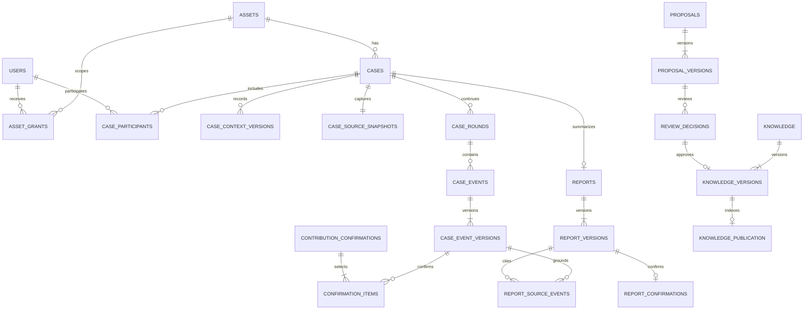

# Bước 5 — Chuẩn hóa dữ liệu nghiệp vụ cho RAG CNC

Bản triển khai local ngày 10/10/2026. Phạm vi tiếp tục từ bước 4: CNC rung/nhiệt độ bất thường, tài liệu và lịch sử đều mô phỏng. Thông tin chức năng HozenDX do người dùng cung cấp là căn cứ thiết kế nghiệp vụ, chưa xác minh API hoặc kết nối dữ liệu.

## 1. Kết quả và phạm vi

Đã chuẩn hóa SQLite hiện tại, có migration kèm backup; không xóa hoặc tạo lại DB người dùng. API đọc hồ sơ lấy bối cảnh, snapshot nguồn và nhật ký từ các bảng đã chuẩn hóa. Giao diện backend có chỉnh 5M1E, mở/kết thúc đợt, thêm ghi nhận, đính chính có lý do, xem lịch sử và xác nhận nhóm đóng góp.

| Nhóm | Cấu trúc lưu trữ | API/giao diện đang hoạt động |
|---|---|---|
| Người dùng, quyền máy, thành viên | Kế thừa bước 4 | Đăng nhập, kiểm tra phạm vi mỗi request |
| Thiết bị, bối cảnh, snapshot nguồn | Có phiên bản/nguồn gốc | Đọc nguồn mock; tạo BM; sửa bối cảnh và 5M1E |
| Đợt xử lý và nhật ký | Quan hệ và phiên bản bất biến | Mở/kết thúc đợt, thêm/sửa ghi nhận, xem lịch sử |
| Xác nhận đóng góp chuyên gia | Nhóm tham chiếu event/revision | Chuyên gia xác nhận đúng phần mình thực hiện |
| Checklist PM/kết quả | Bảng và phiên bản đã chuẩn bị | Chưa tạo PM hoặc nhập kết quả PM qua API |
| Báo cáo và nguồn nhật ký | Bảng, snapshot, xác nhận đã chuẩn bị | Chưa có luồng soạn/xác nhận báo cáo |
| Đề xuất và duyệt | Bảng, phiên bản, người đóng góp, quyết định | Chưa có API gửi/phân công/duyệt |
| Tri thức và xuất bản | Nội dung phiên bản, trạng thái index/hiệu lực, outbox | Chưa có worker index, vector store hoặc API RAG |

SQLite giữ cho demo chạy ngay với môi trường hiện có. PostgreSQL/pgvector chưa được cài hoặc triển khai; chuyển hệ quản trị trước pilot nhiều người dùng và nhập kho RAG thực tế là công việc tiếp theo. Không coi các bảng đã chuẩn bị là luồng nghiệp vụ đã hoàn chỉnh.

## 2. Quan hệ dữ liệu



Một số quan hệ trong sơ đồ biểu diễn ràng buộc nghiệp vụ: bảng `cases` cũ liên kết thiết bị bằng trigger để bảo toàn bảng và khóa ngoại hiện có. Các bảng mới dùng khóa ngoại; tham chiếu event/round/case là khóa ghép để tránh gắn dữ kiện sang hồ sơ khác.

## 3. Quy tắc dữ liệu đang thực thi

**Hồ sơ và đợt:** giữ nguyên `caseId` khi tiếp tục công việc. Mỗi hồ sơ có tối đa một đợt `active`. Chủ hồ sơ maintenance mở và kết thúc đợt; kết thúc đợt bắt buộc tóm tắt/việc còn lại, chuyển công việc sang `waiting`. Không tự xác nhận máy phục hồi hoặc báo cáo. `machine_state`, `work_state`, `report_state` độc lập. Dữ liệu cũ thiếu trạng thái đợt nhận `legacy`, không suy đoán đã kết thúc hay đang làm.

**Nhật ký:** `case_events` giữ danh tính và con trỏ revision hiện hành; `case_event_versions` giữ từng nội dung bất biến. Năm loại: observation/check/hypothesis/action/result. `performed_by` là người thực hiện, `recorded_by` là người nhập. Người thực hiện phải là thành viên đang có quyền máy, vai trò maintenance/expert. Server tự xác định người ghi và thời điểm ghi. Thời điểm thực hiện chưa rõ giữ NULL; giá trị nhập mới cần múi giờ và được đổi sang UTC. Số đo cần đơn vị; không tạo số đo từ văn bản hay tự suy ra nguyên nhân.

**Đính chính:** chỉ người ghi hoặc người thực hiện được sửa, khi công việc chưa kết thúc. Phải gửi revision hiện hành và lý do; thêm revision mới thay vì UPDATE nội dung cũ. Phiên bản được nối tuần tự; trigger chặn UPDATE/DELETE các bảng lịch sử. Không hỗ trợ xóa ghi nhận hoặc chuyển sang đợt/hồ sơ khác.

**Xác nhận:** chuyên gia chọn nhiều ghi nhận mình thực hiện. Mỗi mục gắn chính xác `eventId + revision`; server kiểm tra cả quyền, người thực hiện và revision. Sửa một mục giữ nguyên xác nhận cũ để truy vết, nhưng mục ở revision mới trở thành chưa xác nhận. Các mục không đổi trong cùng nhóm vẫn được xác nhận. Xác nhận đóng góp không đồng nghĩa xác nhận báo cáo; vẫn có thể xác nhận đóng góp sau khi kết thúc công việc.

**Đồng thời và retry:** mọi ghi nghiệp vụ yêu cầu CSRF, Idempotency-Key và expected revision. Ghi nhận kiểm tra thêm expectedRevision; kết thúc đợt kiểm tra expectedRoundRevision. Tăng `caseDataRevision` khi bối cảnh/đợt/ghi nhận/xác nhận thay đổi. Hash snapshot bao gồm bối cảnh hiện hành, revision toàn hồ sơ, hash nguồn, danh sách event/revision và đợt/revision/trạng thái. Hash này chưa chứa kết quả PM vì chưa có API nhập PM; phải mở rộng trước khi triển khai PM.

Transaction `BEGIN IMMEDIATE` bao gồm thay đổi, audit và kết quả thao tác để tránh ghi nửa chừng. Cùng khóa/payload trả cùng kết quả; khác nội dung hoặc khác đối tượng báo 409. UI đọc lại dữ liệu sau khi lưu/replay. Khi sửa một biểu mẫu, biểu mẫu khác tạm khóa để tránh mất bản đang nhập khi render lại. Phiên hết hạn giữ DOM trong tab; xung đột giữ phần nhập để đối chiếu.

## 4. Cấu trúc chuẩn bị cho báo cáo và tri thức

| Bảng chính | Ý nghĩa/ràng buộc |
|---|---|
| `report_versions` | Nội dung, trạng thái nguyên nhân, bằng chứng, sourceDataRevision, snapshot và hash; nguyên nhân confirmed cần bằng chứng |
| `report_source_events` | Nguồn đến đúng event/revision, phải cùng hồ sơ với báo cáo |
| `report_confirmations` | Xác nhận đúng revision bởi chủ hồ sơ maintenance đang hoạt động; công việc đã kết thúc và sourceDataRevision còn đúng; đóng góp chuyên gia cần xác nhận hiện hành |
| `proposal_versions` | new/update/link; nguồn báo cáo phải là revision đã xác nhận; cùng phạm vi máy; update/link cần đích knowledge/version |
| `proposal_contributors` | Người tham gia theo revision đề xuất để kiểm tra độc lập |
| `review_decisions` | Chuyên gia trưởng đang có quyền máy; không phải tác giả/người đóng góp hoặc người ghi/thực hiện trong nguồn nhật ký được dẫn; đúng revision hiện hành |
| `knowledge_versions` | Chỉ từ quyết định approved của đề xuất nội dung; giữ đúng nội dung JSON đã duyệt và đúng phiên bản đích |
| `knowledge_publication` | Index queued/building/ready/failed tách khỏi hiệu lực valid/withdrawn/needs_review và thời gian hiệu lực |
| `knowledge.active_version` | Ban đầu NULL; chỉ kích hoạt phiên bản có publication ready + valid |
| `knowledge_case_links` | Đề xuất link đã được duyệt tạo liên kết case → knowledge/version, không sinh phiên bản nội dung trùng |
| `outbox_events` | Chuẩn bị sự kiện xuất bản; unique loại/đối tượng/phiên bản giúp khử trùng |

Các trigger là rào chắn dữ liệu, chưa thay thế service nghiệp vụ. Khi triển khai luồng báo cáo/duyệt/RAG cần thêm: kiểm tra nguồn báo cáo đầy đủ, workflow chuyển trạng thái, phân công duyệt, bảo đảm danh sách người đóng góp đầy đủ, đóng băng bản xác nhận, xử lý đề xuất cùng baseVersion, tạo/kiểm tra hash nội dung và snapshot trong service, outbox worker/retry, hiệu lực theo thời gian và thu hồi quyền ngay lúc truy xuất. Không dùng riêng `active_version` làm điều kiện đủ cho RAG: truy vấn còn phải kiểm tra quyền, hiệu lực, ngày hiệu lực, index-ready và trạng thái nguồn.

## 5. Migration và bảo toàn dữ liệu

Migrations: `002_domain.sql`, `003_domain_guards.sql`, `004_provenance_guards.sql`; theo dõi bằng `schema_migrations`. `initialize` chạy migration lúc khởi động, hoặc chạy rõ ràng:

```powershell
py -m backend.manage migrate
```

Nếu có hồ sơ, trước nâng cấp tạo bản SQLite backup `.runtime/smartmaint.pre-v4-<uuid>.sqlite3`; đường dẫn ghi vào schema_migrations. Backup trước v2/v3 từ lần nâng cấp trước vẫn giữ nguyên. Không thay mật khẩu hoặc quyền, không nhập localStorage, không dùng lệnh init để reset DB.

V1 → hiện tại: giữ nguyên hàng `cases`, tài khoản/password hash, session, audit và operation cũ; lưu nguyên hàng case vào `legacy_case_snapshots`, đưa snapshot nguồn và context hiện hành vào bảng riêng, tách rounds/events thành quan hệ. Chỉ backfill context revision đang có, không tái dựng các revision trước từ giả định. Thời điểm hoặc danh tính thiếu giữ NULL. `year` trong fixture chưa rõ nghĩa nên giữ trong metadata, không tự ghi `installed_year`.

Các cột JSON cũ giữ để tương thích và đối chiếu. API hiện đọc bảng chuẩn hóa; `context_json` chỉ được cập nhật như cache tương thích. `rounds_json` và `source_snapshot_json` không phải nguồn cho nhật ký hiện hành. Không sửa JSON cũ để điều khiển API.

Migration schema/backfill/marker cùng transaction; lỗi rollback và giữ bản backup để điều tra. Rerun không tạo thêm dữ liệu hoặc backup nếu đã đạt version 4. Sau migration kiểm tra `PRAGMA foreign_key_check`. Khôi phục thủ công phải dừng server, chọn đúng backup và chạy phiên bản mã tương thích; chưa có nút restore tự động.

## 6. API bổ sung

Base `/api/cases/{caseId}`; tất cả route kiểm tra session + quyền máy + tham gia hồ sơ.

| Method/path | Payload chính |
|---|---|
| GET `/journal` | Các đợt, revision, trạng thái xác nhận và snapshot hash |
| POST `/rounds` | expectedCaseDataRevision |
| POST `/rounds/{roundId}/end` | expectedCaseDataRevision, expectedRoundRevision, summary, remainingWork |
| POST `/rounds/{roundId}/events` | expectedCaseDataRevision, type, content, performedBy; result/rationale/số đo/thời điểm tùy chọn |
| PUT `/events/{eventId}` | Như tạo + expectedRevision + correctionReason |
| GET `/events/{eventId}/versions` | Toàn bộ phiên bản ghi nhận trong phạm vi truy cập |
| POST `/contribution-confirmations` | expectedCaseDataRevision, items[{eventId, revision}] |

Không nhận `recordedBy`, trạng thái xác nhận hoặc role từ client để tự cấp quyền. Chỉ tạo ghi nhận trong đợt active; sửa đợt cũ là đính chính có lịch sử. 404 với hồ sơ ngoài phạm vi; 409 khi nguồn đổi, công việc đã kết thúc, đợt không phù hợp hoặc khóa retry xung đột; 422 khi payload sai.

## 7. Kiểm chứng và bước tiếp theo

Kết quả kiểm tra ngày 10/10/2026: **57 bài pytest đạt**; Edge browser smoke đạt luồng đăng nhập, lưu dữ liệu, phục hồi phiên, mở/kết thúc đợt, đính chính ghi nhận, xác nhận nhóm và phân quyền. DB demo hiện có giữ nguyên 5 tài khoản, 1 hồ sơ, 2 đợt và 4 ghi nhận; kiểm tra khóa ngoại không có lỗi.

```powershell
py -m pytest backend/tests -q
py -m backend.browser_smoke
```

Test migration dùng DB v1 tạm, kiểm tra giữ nguyên tài khoản/hồ sơ/audit, backup có dữ liệu trước nâng cấp, rerun idempotent và rollback khi nguồn hỏng. Test nghiệp vụ kiểm tra vòng đời đợt, revision, retry, phân quyền, số đo/đơn vị, người ghi/người thực hiện, xác nhận một nhóm rồi đính chính một mục, bất biến lịch sử và rào chắn duyệt/xuất bản. Browser smoke chạy Edge với DB riêng để kiểm tra nhập/lưu, phục hồi phiên, nhật ký, đính chính và xác nhận nhóm.

Tiếp theo: chốt lược đồ PostgreSQL từ mô hình này; hoàn thiện các service báo cáo/duyệt; chuẩn bị pipeline nhập tài liệu và truy xuất có quyền. Dữ liệu demo không được trộn vào kho thực tế. Chỉ kết nối HozenDX khi có thông tin đã xác minh về phương thức truy cập/quyền/schema/dữ liệu mẫu.

Tham chiếu kỹ thuật: [SQLite foreign keys](https://www.sqlite.org/foreignkeys.html), [transactions](https://www.sqlite.org/lang_transaction.html), [triggers](https://www.sqlite.org/lang_createtrigger.html). Căn cứ nghiệp vụ là BPMN và sequence người dùng cung cấp, cùng [thiết kế RAG](DENSO-RAG-DESIGN.md).
