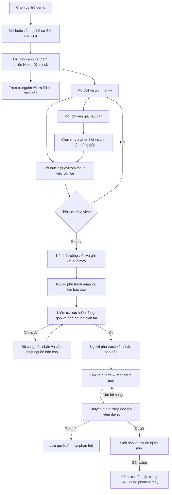

# Đối chiếu chương trình với BPMN và sơ đồ tuần tự

Ngày kiểm tra: 11/10/2026. Phạm vi: mã nguồn hiện tại và các kiểm thử luồng trên database tạm, không thay đổi database đang sử dụng.

## Kết luận

**Chương trình thực hiện được luồng BM chính của bản demo, nhưng chưa triển khai đầy đủ hai bộ sơ đồ.** Những phần chỉ có trong prototype, lời ghi chú hoặc biểu mẫu không được tính là đã có nghiệp vụ lưu trên máy chủ.

Tài liệu được đối chiếu:

- `denso-maintenance-workflows-BPMN (1).drawio`: 5 trang BPMN.
- `denso-maintenance-sequences (2).drawio`: trang bản đồ và 16 trang SQ01–SQ16.

Đây là kiểm tra sự phù hợp của chức năng và điều kiện chuyển trạng thái qua mã nguồn, kết hợp kiểm thử hiện có. Không phải chứng minh hình thức mọi đường đi trong sơ đồ, cũng không phải kiểm thử thủ công toàn bộ màn hình hoặc kiểm chứng với hệ thống HozenDX thật.

## Luồng BM đang có xử lý trên database



Tra cứu có thể thực hiện nhiều lần trong quá trình xử lý, không bắt buộc trước mỗi ghi nhận. Xác nhận đóng góp có thể thực hiện trước khi lập báo cáo; sơ đồ trên chỉ thể hiện điểm kiểm tra bắt buộc trước khi chốt. Nếu xác nhận làm thay đổi bản nguồn, cần lưu lại báo cáo với nguồn hiện tại.

## Đối chiếu 5 trang BPMN

| Trang | Kết quả | Phần đã có và khác biệt |
| --- | --- | --- |
| 01 — Ghi nhận tri thức chuyên gia | Chưa có luồng backend đầy đủ | Backend nhận đề xuất từ báo cáo BM đã xác nhận. Nhập kinh nghiệm trực tiếp, AI cấu trúc, đối chiếu trùng, cập nhật tri thức cũ và liên kết nguồn cũ chưa có chuỗi API tương ứng. |
| 02 — Hồ sơ BM/PM, tổng quan | Khớp một phần | BM có hồ sơ, nhiều đợt, hỗ trợ chuyên gia, nhật ký, báo cáo và đề xuất. PM chưa có chuỗi thao tác lưu database tương đương BM. |
| 03 — Mở/tiếp tục và điền sẵn | Khớp một phần | BM có xác nhận máy demo, kiểm tra quyền, bản chụp nguồn và lý do mở công việc độc lập khi máy còn hồ sơ mở. Chưa có tích hợp HozenDX thật, quét mã và thực thi kế hoạch PM. |
| 04 — Đợt xử lý, phối hợp, ghi nhanh | Khớp phần BM cốt lõi | Có nhiều đợt trong cùng hồ sơ, mời/nhận/từ chối/hủy hỗ trợ, nhật ký có người thực hiện và người ghi, xác nhận đúng phiên bản. Thiếu bàn giao đầy đủ cho người/đơn vị nhận, AI tóm tắt và nhánh PM. |
| 05 — AI tổng kết, xác nhận, lưu báo cáo | Khớp một phần | Có phiên bản báo cáo, nguồn nhật ký, xác nhận chuyên gia và người phụ trách, tách trạng thái máy/công việc/báo cáo. Báo cáo nhập thủ công; chưa có AI tổng kết, xem nháp khi công việc còn mở, yêu cầu sửa đóng góp đầy đủ, đính chính sau chốt hoặc đồng bộ báo cáo HozenDX. |

## Đối chiếu 16 sơ đồ tuần tự

Các mức dưới đây đánh giá toàn bộ yêu cầu của từng trang. “Khớp phần cốt lõi” vẫn có phần giản lược, không đồng nghĩa hoàn thành mọi bước.

| SQ | Kết quả | Bằng chứng triển khai và giới hạn |
| --- | --- | --- |
| SQ01 — Đăng nhập/không gian làm việc | Giản lược có chủ đích | Có API đăng nhập, phiên và quyền máy. Bản demo dùng chọn vai trò theo yêu cầu trước đây, khác đăng nhập tài khoản cá nhân được cấp quyền trong sơ đồ. Xem [main.py](../../backend/main.py), [backend.js](../../frontend/prototype/backend.js). |
| SQ02 — Nhập tri thức, AI cấu trúc | Chưa có backend tương ứng | [knowledge.js](../../frontend/prototype/knowledge.js) có bộ phân loại ghi chú theo nhãn, ghi rõ AI mô phỏng. Không phải Gemini cấu trúc tri thức và không có API lưu bản gốc/nháp trực tiếp cho chuyên gia. |
| SQ03 — Đối chiếu, xử lý trùng | Chưa có backend tương ứng | Prototype có đối chiếu theo loại máy/từ khóa. Backend chưa lưu kết quả so sánh theo revision và chưa hỗ trợ đủ ba hướng mới/cập nhật/liên kết. |
| SQ04 — Xác nhận và gửi kiểm duyệt | Khớp một phần | Đề xuất từ báo cáo có phiên bản, trạng thái chờ và chống gửi lặp. Chưa bắt buộc đối chiếu trùng ở backend, chưa phân công người duyệt và thông báo lưu trên máy chủ. Xem [knowledge.py](../../backend/knowledge.py). |
| SQ05 — Chuyên gia trưởng quyết định | Khớp phần cốt lõi | Kiểm tra vai trò, quyền máy, độc lập với tác giả/người đóng góp, đúng revision và trạng thái chờ. Có duyệt/yêu cầu bổ sung/từ chối kèm phản hồi. Chưa có luồng sửa biên tập bởi người duyệt với đối chiếu trước/sau riêng. |
| SQ06 — Tác giả hoàn thiện và gửi lại | Khớp phần cốt lõi | Tác giả sửa đề xuất cần bổ sung, tạo revision và gửi lại, lưu lịch sử quyết định. Chưa có xử lý từng mục phản hồi và đối chiếu trùng bắt buộc trước mỗi lần gửi lại. |
| SQ07 — Xuất bản và theo dõi | Khớp phần tạo tri thức mới | Đã duyệt chưa lập tức xuất hiện trong RAG; chỉ xuất bản sau khi chỉ mục sẵn sàng. Có trạng thái lỗi/thử lại. Chưa có cập nhật phiên bản tri thức cũ, nhánh chỉ liên kết hoặc thông báo thực. |
| SQ08 — Mở BM/PM và HozenDX | Khớp phần BM demo | API tạo hồ sơ chỉ nhận BM, adapter chỉ hỗ trợ CNC-04 mock. Có nguồn và bối cảnh tách biệt, quyền máy và kiểm tra hồ sơ mở. Chưa có PM đầy đủ. Xem [main.py](../../backend/main.py), [hozendx.py](../../backend/hozendx.py). |
| SQ09 — RAG hỗ trợ chọn hướng | Khớp một phần | Có từ khóa/vector tùy cấu hình, câu trả lời mẫu/Gemini, trích dẫn phiên bản, kiểm tra quyền và dữ liệu đổi trong lúc gọi. **Truy vấn lấy câu hỏi người dùng và phạm vi máy; chưa tự tổng hợp toàn bộ bối cảnh/nhật ký.** Chưa lưu lịch sử retrieval và quyết định chọn hướng xử lý vào database. Xem [search.py](../../backend/rag/search.py), [answers.py](../../backend/rag/answers.py). |
| SQ10 — Gọi chuyên gia | Khớp phần cốt lõi | Có yêu cầu hỗ trợ, nhận/từ chối/hủy, kiểm tra quyền và thêm người tham gia khi nhận. Chưa có AI soạn nội dung bàn giao hoặc ghi đầy đủ thời điểm/giai đoạn tham gia thực tế theo từng đợt. Xem [workflow.py](../../backend/workflow.py). |
| SQ11 — Đợt, PM, bàn giao, tiếp tục | Khớp một phần | Có một đợt hoạt động tại một thời điểm, tiếp tục cùng hồ sơ, kết thúc đợt với tóm tắt và việc còn lại. Thiếu PM, AI tóm tắt, người/đơn vị nhận bàn giao. Nhánh kết thúc khi chưa phục hồi chưa kiểm tra quyết định đúng thẩm quyền như sơ đồ. Xem [journal.py](../../backend/journal.py), [workflow.py](../../backend/workflow.py). |
| SQ12 — AI báo cáo/xác nhận | Khớp một phần | Báo cáo lưu phiên bản và bản chụp nguồn các đợt/sự kiện; chốt cần các đóng góp chuyên gia đúng phiên bản và nguồn hiện tại. Nội dung do người dùng nhập, chưa có AI soạn, xem nháp khi đang làm, phản hồi yêu cầu sửa đầy đủ, đính chính sau chốt hay hàng chờ đồng bộ HozenDX. |
| SQ13 — Báo cáo thành tri thức | Khớp phần tạo mới | Chỉ báo cáo đã xác nhận được tạo đề xuất; giữ nguồn báo cáo và người đóng góp, qua duyệt độc lập. Chưa có AI đề xuất hướng mới/cập nhật/liên kết và chưa có API cho hai hướng sau. |
| SQ14 — Mở nguồn/ghi nhận tham khảo | Khớp một phần | Mở đúng id và phiên bản nguồn đang khả dụng trong phạm vi máy. Chưa ghi database riêng các mức đã đọc/đã chọn/đã áp dụng/kết quả áp dụng, chưa có phản hồi nguồn gắn với hồ sơ. |
| SQ15 — Ngoại lệ/bảo toàn dữ liệu | Khớp nhiều cơ chế cốt lõi | Backend có idempotency, kiểm tra phiên bản/quyền, từ chối kết quả RAG lỗi thời. Workspace có giữ phần nhập khi phục hồi phiên; không có bằng chứng mọi biểu mẫu đều có cơ chế khôi phục tương đương. Chưa có giao diện hợp nhất khác biệt đầy đủ. |
| SQ16 — Ghi nhanh/xác nhận nhóm | Khớp phần cốt lõi | Có loại sự kiện, người thực hiện/người ghi, thời điểm thực tế/thời điểm lưu, số đo/đơn vị, đính chính có lý do và lịch sử, xác nhận nhóm đúng revision; không xác nhận thay. Thiếu vòng yêu cầu sửa/thông báo và AI hỏi bổ sung đầy đủ. |

## Những khác biệt cần chú ý khi trình bày

1. **Có mã prototype không có nghĩa màn hình đang chạy dùng mã đó.** `frontend/index.html` tải `knowledge-api.js` sau `knowledge.js`. File sau thay các trang kho/đề xuất/kiểm duyệt bằng phiên bản dùng API. Các thao tác AI cấu trúc và đối chiếu trong prototype không chứng minh luồng backend hiện tại đã hỗ trợ chúng.
2. **Gemini hiện phục vụ trả lời RAG.** `answers.py` nhận câu hỏi và các đoạn nguồn. Bật Gemini/vector không tự bổ sung AI soạn báo cáo, tóm tắt bàn giao hoặc cấu trúc tri thức trong những trang SQ khác.
3. **Xem trước báo cáo bị giới hạn hơn sơ đồ.** `save_report()` trong `workflow.py` yêu cầu công việc BM đã kết thúc. SQ12 cho phép xem/lưu nháp trong lúc đang làm mà không đóng công việc.
4. **Đóng công việc chưa phục hồi còn thiếu điều kiện.** `finish()` kiểm tra người phụ trách, revision, không còn đợt đang chạy, có nhật ký và không còn lời mời chờ. Body chỉ có trạng thái máy và bằng chứng; chưa có quyết định/chấp thuận đúng thẩm quyền và nơi tiếp nhận theo SQ11. Không nên trình bày nhánh này là đã tuân thủ đầy đủ quy trình.
5. **Sau chốt đang khóa sửa thay vì có luồng đính chính.** Báo cáo đã xác nhận không được sửa; nhật ký nguồn cũng bị khóa khi công việc kết thúc. Đây là bảo toàn dữ liệu, nhưng chưa thay thế được quy trình đính chính có lý do, phiên bản và tái xác nhận phần bị ảnh hưởng trong sơ đồ.
6. **HozenDX và thông báo vẫn có phần mô phỏng.** Adapter đọc fixture, chưa ghi báo cáo vào HozenDX. Thông báo trên giao diện prototype chưa phải hệ thống thông báo nghiệp vụ lưu trên máy chủ. Việc dùng mock phù hợp phạm vi demo đã thống nhất, cần ghi rõ khi thuyết trình.

## Kiểm chứng đã chạy trong lần rà soát này

```powershell
py -m pytest backend/tests/test_workflow.py backend/tests/test_knowledge.py backend/tests/test_domain.py backend/tests/test_search.py -q
```

Kết quả: **55 passed in 28.51s**. Lần chạy đầu bị quyền truy cập thư mục tạm của Windows; đã chạy lại với quyền cần thiết và đạt toàn bộ. Các kiểm thử dùng database tạm và mặc định offline; không gọi Gemini thật, không reset database của người dùng.

Các nhóm này kiểm tra vòng đời đợt, revision nhật ký/xác nhận, lời mời hỗ trợ, báo cáo bất biến sau chốt, duyệt độc lập, xuất bản và trích dẫn, quyền truy cập, dữ liệu lỗi thời. Một số kiểm thử vector dùng giả lập provider; kết quả không chứng minh chất lượng Gemini hoặc tích hợp HozenDX thật.

**Kiểm thử đạt xác nhận phần đã triển khai hoạt động theo các kiểm thử hiện có; không chứng minh những bước còn thiếu trong sơ đồ đã hoàn thành.**

## Phạm vi phù hợp cho bản nộp demo

Có thể mô tả: “Demo luồng xử lý sự cố BM CNC, ghi nhận theo đợt, xác nhận đóng góp, báo cáo có phiên bản và kiểm duyệt tri thức để tái sử dụng qua RAG; HozenDX dùng dữ liệu mô phỏng.”

Chưa nên mô tả: “Triển khai đầy đủ BPMN/SQ01–SQ16, BM/PM và toàn bộ chức năng AI.”

Nếu tiếp tục hoàn thiện theo sơ đồ, ưu tiên điều kiện đóng công việc chưa phục hồi và xem nháp báo cáo khi đang làm; sau đó bổ sung AI tổng kết từ nhật ký, luồng tri thức trực tiếp/đối chiếu/cập nhật/liên kết, rồi PM, bàn giao, thông báo và ghi nhận việc áp dụng nguồn. Tích hợp HozenDX thật cần thông tin API và quyền truy cập từ đơn vị sở hữu.
