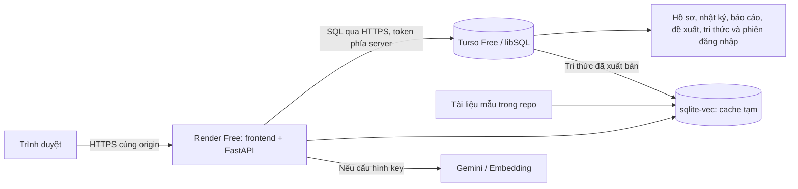

# Live Demo miễn phí: Render + Turso

Repo: [DENSO_Knowledge_Graph](https://github.com/nguyenhoangduong17122005-glitch/DENSO_Knowledge_Graph).

**Trạng thái:** có adapter database từ xa và cấu hình hosting; chưa tạo service trong tài khoản của bạn, chưa có URL Live Demo được xác minh. Không cần mua Persistent Disk.

## Kiến trúc



`SMARTMAINT_STORAGE=turso` chuyển dữ liệu nghiệp vụ sang libSQL qua HTTPS. App chỉ trả ghi thành công sau khi COMMIT từ xa thành công. Khi database online lỗi, app báo lỗi, không âm thầm ghi vào SQLite tạm.

Render Free không có disk bền vững và mất file tạm khi restart/redeploy. Hồ sơ được lưu tại Turso; vector index có thể tạo lại từ tài liệu mẫu và tri thức đã xuất bản. **Database local không tự upload lên cloud**; lần đầu cloud trống được tạo với 5 hồ sơ mô phỏng. [Render Free](https://render.com/docs/free), [Turso Free](https://turso.tech/pricing).

## 1. Tạo database Turso Free

1. Mở [Turso](https://turso.tech/), đăng ký/đăng nhập và chọn **Free**. Giữ trong hạn mức miễn phí; không bật nâng cấp hoặc trả tiền vượt hạn mức.
2. Tạo database `denso-smartmaint-demo`, chọn engine **libSQL**, vùng gần vùng Render dự định dùng. Adapter sử dụng SQLite schema/trigger và libSQL HTTP v2; chưa hỗ trợ engine Turso mới.
3. Sao chép **Database URL**, dạng `libsql://...turso.io`.
4. Tạo **database token đọc/ghi**, lưu riêng. Đây là database token, không phải Platform API token. Không gửi token vào chat/GitHub hoặc đặt trong frontend.
5. Giữ database trống; không tạo bảng mẫu `users` theo tutorial khác. App tự khởi tạo schema và dữ liệu demo một lần.

Nếu dùng CLI trên WSL/macOS/Linux, làm theo [Turso Quickstart](https://docs.turso.tech/quickstart), rồi chạy:

```bash
turso auth login
turso db create denso-smartmaint-demo
turso db show denso-smartmaint-demo --url
turso db tokens create denso-smartmaint-demo
```

Không thêm `--tursodb`: cờ đó chọn engine Turso mới. Lệnh token hiển thị bí mật trong terminal của bạn; không chụp ảnh đầu ra. Xem [tạo database](https://docs.turso.tech/cli/db/create) và [SQL qua HTTP](https://docs.turso.tech/sdk/http/reference).

## 2. Tạo Render Web Service miễn phí

1. Đăng nhập [Render](https://dashboard.render.com/), kết nối GitHub.
2. Chọn **New → Blueprint**, repo trên, branch `main`. `render.yaml` đặt `plan: free`, runtime Docker, không có disk trả phí.
3. Nhập `TURSO_DATABASE_URL` và `TURSO_AUTH_TOKEN` khi Render yêu cầu. Dán token trực tiếp trong Render; không commit giá trị vào YAML.
4. Kiểm tra service ở gói **Free** rồi tạo Blueprint. Nếu dashboard chỉ hiển thị phương án có phí, dừng tạo và kiểm tra cấu hình/tài khoản.
5. Chờ build/deploy. Lần đầu app tạo 5 hồ sơ và 5 tài khoản demo trong cloud trống; các lần sau giữ nguyên dữ liệu. Schema remote cũ/không tương thích phải backup và migration riêng, app không tự xóa.
6. Mở URL HTTPS Render cấp. App tự nhận `RENDER_EXTERNAL_HOSTNAME`, kiểm tra host/origin và đặt cookie Secure.

Nếu tạo **New → Web Service** thủ công: chọn Docker, branch `main`, gói Free, health check `/api/health`, nhập:

| Biến | Giá trị |
|---|---|
| `SMARTMAINT_STORAGE` | `turso` |
| `TURSO_DATABASE_URL` | Database URL thực tế |
| `TURSO_AUTH_TOKEN` | Database token đọc/ghi riêng |
| `SMARTMAINT_SECURE_COOKIE` | `1` |
| `SMARTMAINT_DEMO_ROLE_SELECTION` | `1` |
| `SMARTMAINT_ANSWER_MODE` | `template` |
| `SMARTMAINT_RETRIEVAL_MODE` | `keyword` |

Dockerfile đã có start command `python -m backend.serve`; không cần Build/Start Command kiểu Python.

## 3. Xác nhận dữ liệu còn sau restart

1. Mở `/api/health`: phải trả `status: ok`; chế độ Turso kiểm tra kết nối database thật.
2. Mở giao diện → chọn **Người bảo trì — Nguyễn Minh** → **Vào bản demo**.
3. Tạo hồ sơ **CLOUD-KT01: Kiểm tra lưu sau restart**, máy `CNC-04`, hiện tượng **Rung tại trục chính sau thay dao; chưa kết luận nguyên nhân**. Xác nhận máy mô phỏng, điền lý do tạo hồ sơ riêng nếu biểu mẫu yêu cầu.
4. Tải lại trang, mở hồ sơ và ghi lại mã BM.
5. Restart service trong Render, chờ sẵn sàng, chọn lại vai trò và tìm mã BM.
6. Trong Turso database shell, đối chiếu:

```sql
SELECT id, title, work_state, updated_at
FROM cases
WHERE title LIKE '%CLOUD-KT01%'
ORDER BY updated_at DESC;
```

7. Thử BM → nhật ký → kết thúc → báo cáo đã xác nhận → đề xuất → duyệt độc lập → xuất bản → tra cứu có citation. Restart và xác nhận tri thức vẫn xuất hiện.
8. Sau khi đạt, gửi **URL giao diện công khai** để kiểm tra/cập nhật link Live Demo trong README. Không gửi token.

## 4. Gemini và vector trên hosting miễn phí

Mặc định dùng từ khóa/trả lời mẫu, không cần API key. Muốn bật Gemini, đặt riêng trong Render:

```dotenv
SMARTMAINT_ANSWER_MODE=gemini
SMARTMAINT_RETRIEVAL_MODE=vector
SMARTMAINT_GEMINI_MODEL=<model bạn có quyền dùng>
SMARTMAINT_EMBEDDING_MODEL=gemini-embedding-001
SMARTMAINT_EMBEDDING_DIMENSIONS=768
SMARTMAINT_VECTOR_MIN_SCORE=0.45
GEMINI_API_KEY=<điền riêng trong Render>
```

Gemini sử dụng hạn mức API của bạn; chỉ bật khi project có hạn mức phù hợp yêu cầu miễn phí. Cold start có thể tạo lại embedding do cache bị xóa, tiêu thụ hạn mức. Nếu index lỗi, app báo fallback; chưa thể coi vector/Gemini đã hoạt động. Xem [hướng dẫn Gemini](DENSO-RAG-VECTOR-GEMINI.md).

## 5. Kiểm tra từ máy local (tùy chọn)

Thêm riêng vào `.env` (không đưa lên GitHub):

```dotenv
SMARTMAINT_STORAGE=turso
TURSO_DATABASE_URL=libsql://<database-thực-tế>.turso.io
TURSO_AUTH_TOKEN=<database-token-riêng>
```

Chạy từ thư mục dự án:

```powershell
py -m backend.check_storage
py -m backend.serve
```

`check_storage` chỉ đọc, hiển thị kết nối/schema và số hồ sơ/tri thức; database mới có `schemaReady: false` đến lần khởi tạo. Dừng server cũ trước khi dùng cùng cổng 8001. Có thể dùng `docker compose up --build -d`: Compose chuyển tiếp cấu hình Turso.

Đổi `SMARTMAINT_STORAGE=sqlite` để dùng file local cũ, vẫn được giữ nguyên. Dữ liệu cloud và local là hai nguồn độc lập. `backend.export_cases` chỉ xuất SQLite local; để xem cloud dùng giao diện hoặc Turso shell.

## Giới hạn và bằng chứng kiểm tra

- Render Free ngủ khi không hoạt động, lần truy cập sau có thể phải chờ khởi động. Đây là bản demo, không phải SLA production.
- libSQL giới hạn thời gian transaction. Khởi tạo schema/dữ liệu được gộp thành một sequence; chọn vùng gần backend, giữ dữ liệu nhỏ và một instance. Cần kiểm tra luồng thật trên cloud trước khi bàn giao.
- Khi mất phản hồi COMMIT, database có thể đã ghi nhưng app nhận lỗi 503. Tải lại hồ sơ trước khi gửi lại; API ghi vẫn có khóa chống lặp. Adapter không tự retry ghi.
- Token hết hạn/hạn mức hết làm kết nối lỗi. Cập nhật token trong Render rồi deploy lại, không reset database để xử lý lỗi xác thực.
- Bộ chọn vai trò dành cho dữ liệu mô phỏng; HozenDX vẫn mock. Chưa đưa dữ liệu nhà máy thực lên bản public này.
- [Docker CI đã đạt](https://github.com/nguyenhoangduong17122005-glitch/DENSO_Knowledge_Graph/actions/runs/38124622577): build/chạy image, chọn vai trò, trả lời mẫu, tạo hồ sơ và giữ hồ sơ sau restart container. [Bản cập nhật miễn phí cũng đã đạt CI](https://github.com/nguyenhoangduong17122005-glitch/DENSO_Knowledge_Graph/actions/runs/38131288432), gồm 170 test và kiểm tra server libSQL thật: tạo lại ứng dụng vẫn giữ hồ sơ, báo cáo → duyệt → xuất bản → RAG có citation.
- Chưa có database/token cloud của bạn, nên chưa xác minh Turso Cloud hoặc URL Render thật. Kiểm tra giao thức local không thay thế kiểm tra triển khai cloud.

## Nếu tiếp tục dùng frontend Netlify

Render trên phục vụ cả frontend/backend cùng origin. **Chưa triển khai frontend Netlify riêng.** Netlify cần backend HTTPS, proxy cookie/CSRF và xử lý tác vụ Gemini/index dài: [proxy Netlify giới hạn 26 giây](https://docs.netlify.com/manage/routing/redirects/rewrites-proxies/). Chỉ upload `frontend` chưa làm database/RAG hoạt động.
